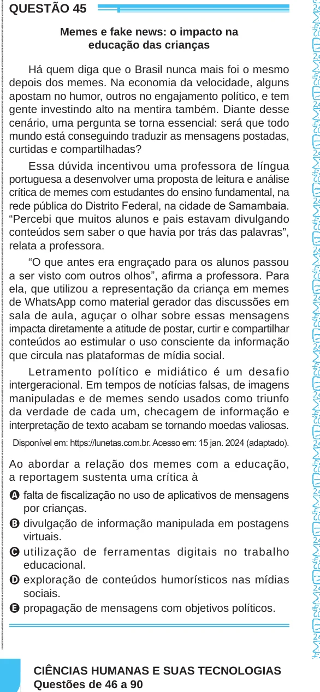

Texto extraído (pode conter ruído)

QUESTÃO 45  
Memes e fake news: o impacto na  
educação das crianças  
Há quem diga que o Brasil nunca mais foi o mesmo  
depois dos memes. Na economia da velocidade, alguns  
apostam no humor, outros no engajamento político, e tem  
gente investindo alto na mentira também. Diante desse  
cenário, uma pergunta se torna essencial: será que todo  
mundo está conseguindo traduzir as mensagens postadas,  
curtidas e compartilhadas?  
Essa dúvida incentivou uma professora de língua  
portuguesa a desenvolver uma proposta de leitura e análise  
crítica de memes com estudantes do ensino fundamental, na  
rede pública do Distrito Federal, na cidade de Samambaia.  
“Percebi que muitos alunos e pais estavam divulgando  
conteúdos sem saber o que havia por trás das palavras”,  
relata a professora.  
“O que antes era engraçado para os alunos passou  
a ser visto com outros olhos”, afirma a professora. Para  
ela, que utilizou a representação da criança em memes  
de WhatsApp como material gerador das discussões em  
sala de aula, aguçar o olhar sobre essas mensagens  
impacta diretamente a atitude de postar, curtir e compartilhar  
conteúdos ao estimular o uso consciente da informação  
que circula nas plataformas de mídia social.  
Letramento político e midiático é um desafio  
intergeracional. Em tempos de notícias falsas, de imagens  
manipuladas e de memes sendo usados como triunfo  
da verdade de cada um, checagem de informação e  
interpretação de texto acabam se tornando moedas valiosas.  
Disponível em: https://lunetas.com.br. Acesso em: 15 jan. 2024 (adaptado).  
Ao abordar a relação dos memes com a educação,  
a reportagem sustenta uma crítica à  
A falta de fiscalização no uso de aplicativos de mensagens  
por crianças.  
B divulgação de informação manipulada em postagens  
virtuais.  
C utilização de ferramentas digitais no trabalho  
educacional.  
D exploração de conteúdos humorísticos nas mídias  
sociais.  
E propagação de mensagens com objetivos políticos.  
CIÊNCIAS HUMANAS E SUAS TECNOLOGIAS  
Questões de 46 a 90

