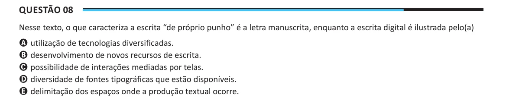

Texto extraído (pode conter ruído)

Questão 08  
Nesse texto, o que caracteriza a escrita “de próprio punho” é a letra manuscrita, enquanto a escrita digital é ilustrada pelo(a)  
A utilização de tecnologias diversificadas.  
B desenvolvimento de novos recursos de escrita.  
C possibilidade de interações mediadas por telas.  
D diversidade de fontes tipográficas que estão disponíveis.  
E delimitação dos espaços onde a produção textual ocorre.

