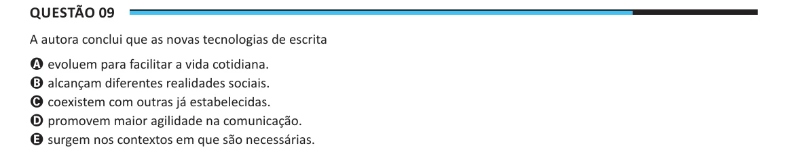

Texto extraído (pode conter ruído)

Questão 09  
A autora conclui que as novas tecnologias de escrita  
A evoluem para facilitar a vida cotidiana.  
B alcançam diferentes realidades sociais.  
C coexistem com outras já estabelecidas.  
D promovem maior agilidade na comunicação.  
E surgem nos contextos em que são necessárias.

