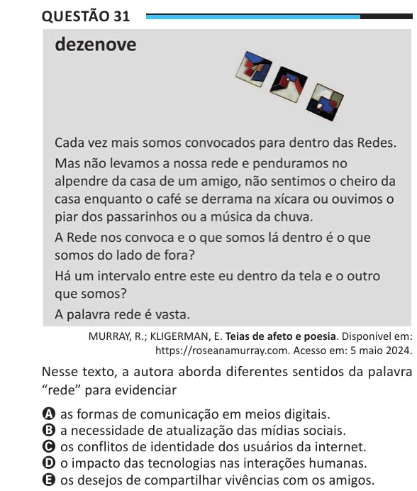

Texto extraído (pode conter ruído)

Questão 31  
MURRAY, R.; KLIGERMAN, E. Teias de afeto e poesia. Disponível em:  
https://roseanamurray.com. Acesso em: 5 maio 2024.  
Nesse texto, a autora aborda diferentes sentidos da palavra  
“rede” para evidenciar  
A as formas de comunicação em meios digitais.  
B a necessidade de atualização das mídias sociais.  
C os conflitos de identidade dos usuários da internet.  
D o impacto das tecnologias nas interações humanas.  
E os desejos de compartilhar vivências com os amigos.

