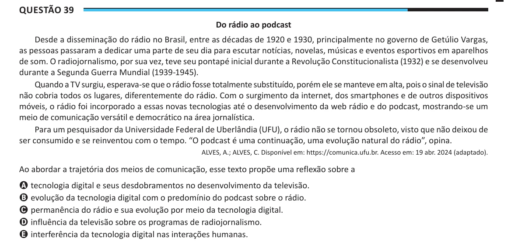

Texto extraído (pode conter ruído)

Questão 39  
Do rádio ao podcast  
Desde a disseminação do rádio no Brasil, entre as décadas de 1920 e 1930, principalmente no governo de Getúlio Vargas,  
as pessoas passaram a dedicar uma parte de seu dia para escutar notícias, novelas, músicas e eventos esportivos em aparelhos  
de som. O radiojornalismo, por sua vez, teve seu pontapé inicial durante a Revolução Constitucionalista (1932) e se desenvolveu  
durante a Segunda Guerra Mundial (1939-1945).  
Quando a TV surgiu, esperava-se que o rádio fosse totalmente substituído, porém ele se manteve em alta, pois o sinal de televisão  
não cobria todos os lugares, diferentemente do rádio. Com o surgimento da internet, dos smartphones e de outros dispositivos  
móveis, o rádio foi incorporado a essas novas tecnologias até o desenvolvimento da web rádio e do podcast, mostrando-se um  
meio de comunicação versátil e democrático na área jornalística.  
Para um pesquisador da Universidade Federal de Uberlândia (UFU), o rádio não se tornou obsoleto, visto que não deixou de  
ser consumido e se reinventou com o tempo. “O podcast é uma continuação, uma evolução natural do rádio”, opina.  
ALVES, A.; ALVES, C. Disponível em: https://comunica.ufu.br. Acesso em: 19 abr. 2024 (adaptado).  
Ao abordar a trajetória dos meios de comunicação, esse texto propõe uma reflexão sobre a  
A tecnologia digital e seus desdobramentos no desenvolvimento da televisão.  
B evolução da tecnologia digital com o predomínio do podcast sobre o rádio.  
C permanência do rádio e sua evolução por meio da tecnologia digital.  
D influência da televisão sobre os programas de radiojornalismo.  
E interferência da tecnologia digital nas interações humanas.

