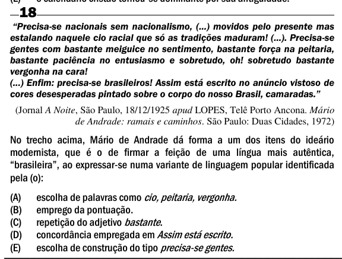

Texto extraído (pode conter ruído)

18  
―Precisa-se nacionais sem nacionalismo, (...) movidos pelo presente mas  
estalando naquele cio racial que só as tradições maduram! (...). Precisa-se  
gentes com bastante meiguice no sentimento, bastante força na peitaria,  
bastante paciência no entusiasmo e sobretudo, oh! sobretudo bastante  
vergonha na cara!  
(...) Enfim: precisa-se brasileiros! Assim está escrito no anúncio vistoso de  
cores desesperadas pintado sobre o corpo do nosso Brasil, camaradas.‖  
(Jornal A Noite, São Paulo, 18/12/1925 apud LOPES, Telê Porto Ancona. Mário  
de Andrade: ramais e caminhos. São Paulo: Duas Cidades, 1972)  
No trecho acima, Mário de Andrade dá forma a um dos itens do ideário  
modernista, que é o de firmar a feição de uma língua mais autêntica,  
“brasileira”, ao expressar-se numa variante de linguagem popular identificada  
pela (o):  
escolha de palavras como cio, peitaria, vergonha.  
(A)  
(B)  
emprego da pontuação.  
(C)  
repetição do adjetivo bastante .  
(D)  
concordância empregada em Assim está escrito.  
(E)  
escolha de construção do tipo precisa-se gentes.

