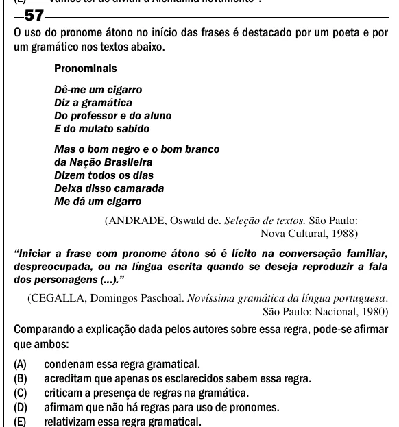

Texto extraído (pode conter ruído)

57  
O uso do pronome átono no início das frases é destacado por um poeta e por  
um gramático nos textos abaixo.  
Pronominais  
Dê-me um cigarro  
Diz a gramática  
Do professor e do aluno  
E do mulato sabido  
Mas o bom negro e o bom branco  
da Nação Brasileira  
Dizem todos os dias  
Deixa disso camarada  
Me dá um cigarro  
(ANDRADE, Oswald de. Seleção de textos. São Paulo:  
Nova Cultural, 1988)  
―Iniciar a frase com pronome átono só é lícito na conversação familiar,  
despreocupada, ou na língua escrita quando se deseja reproduzir a fala  
dos personagens (...).‖  
(CEGALLA, Domingos Paschoal. Novíssima gramática da língua portuguesa.  
São Paulo: Nacional, 1980)  
Comparando a explicação dada pelos autores sobre essa regra, pode-se afirmar  
que ambos:  
(A)  
condenam essa regra gramatical.  
(B)  
acreditam que apenas os esclarecidos sabem essa regra.  
(C)  
criticam a presença de regras na gramática.  
(D)  
afirmam que não há regras para uso de pronomes.  
(E)  
relativizam essa regra gramatical.

