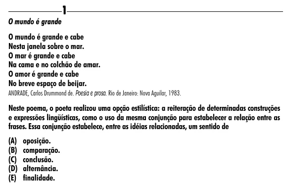

Texto extraído (pode conter ruído)

1  
O mundo é grande  
O mundo é grande e cabe  
Nesta janela sobre o mar.  
O mar é grande e cabe  
Na cama e no colchão de amar.  
O amor é grande e cabe  
No breve espaço de beijar.  
ANDRADE, Carlos Drummond de. Poesia e prosa. Rio de Janeiro: Nova Aguilar, 1983.  
Neste poema, o poeta realizou uma opção estilística: a reiteração de determinadas construções  
e expressões lingüísticas, como o uso da mesma conjunção para estabelecer a relação entre as  
frases. Essa conjunção estabelece, entre as idéias relacionadas, um sentido de  
(A) oposição.  
(B) comparação.  
(C) conclusão.  
(D) alternância.  
(E) finalidade.

