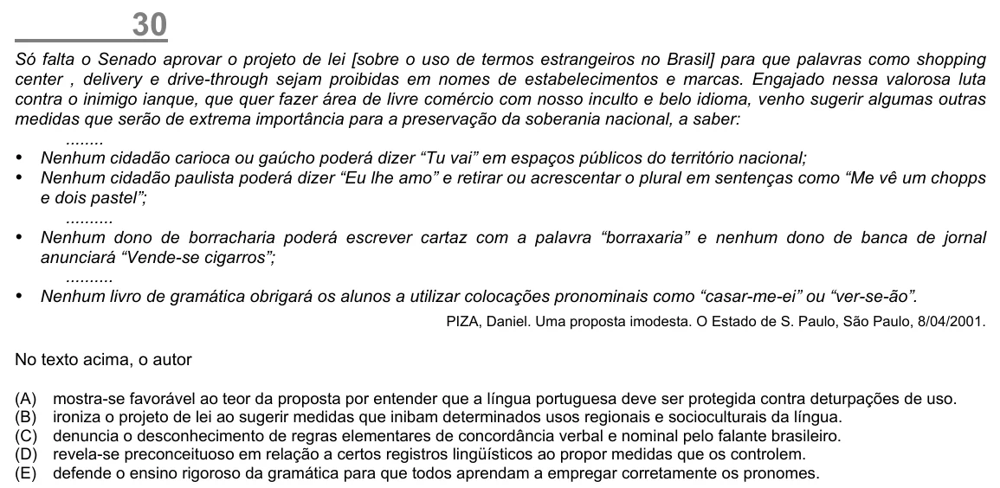

Texto extraído (pode conter ruído)

30  
Só falta o Senado aprovar o projeto de lei [sobre o uso de termos estrangeiros no Brasil] para que palavras como shopping  
center , delivery e drive-through sejam proibidas em nomes de estabelecimentos e marcas. Engajado nessa valorosa luta  
contra o inimigo ianque, que quer fazer área de livre comércio com nosso inculto e belo idioma, venho sugerir algumas outras  
medidas que serão de extrema importância para a preservação da soberania nacional, a saber:  
........  
! Nenhum cidadão carioca ou gaúcho poderá dizer “Tu vai” em espaços públicos do território nacional;  
! Nenhum cidadão paulista poderá dizer “Eu lhe amo” e retirar ou acrescentar o plural em sentenças como “Me vê um chopps  
e dois pastel”;  
..........  
! Nenhum dono de borracharia poderá escrever cartaz com a palavra “borraxaria” e nenhum dono de banca de jornal  
anunciará “Vende-se cigarros”;  
..........  
! Nenhum livro de gramática obrigará os alunos a utilizar colocações pronominais como “casar-me-ei” ou “ver-se-ão”.  
PIZA, Daniel. Uma proposta imodesta. O Estado de S. Paulo, São Paulo, 8/04/2001.  
No texto acima, o autor  
(A)  
mostra-se favorável ao teor da proposta por entender que a língua portuguesa deve ser protegida contra deturpações de uso.  
(B)  
ironiza o projeto de lei ao sugerir medidas que inibam determinados usos regionais e socioculturais da língua.  
(C)  
denuncia o desconhecimento de regras elementares de concordância verbal e nominal pelo falante brasileiro.  
(D)  
revela-se preconceituoso em relação a certos registros lingüísticos ao propor medidas que os controlem.  
(E)  
defende o ensino rigoroso da gramática para que todos aprendam a empregar corretamente os pronomes.

