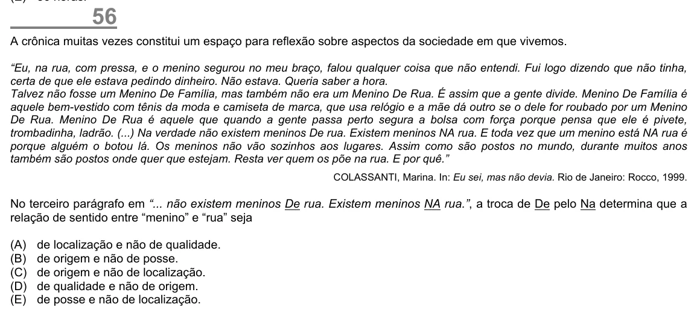

Texto extraído (pode conter ruído)

56  
A crônica muitas vezes constitui um espaço para reflexão sobre aspectos da sociedade em que vivemos.  
“Eu, na rua, com pressa, e o menino segurou no meu braço, falou qualquer coisa que não entendi. Fui logo dizendo que não tinha,  
certa de que ele estava pedindo dinheiro. Não estava. Queria saber a hora.  
Talvez não fosse um Menino De Família, mas também não era um Menino De Rua. É assim que a gente divide. Menino De Família é  
aquele bem-vestido com tênis da moda e camiseta de marca, que usa relógio e a mãe dá outro se o dele for roubado por um Menino  
De Rua. Menino De Rua é aquele que quando a gente passa perto segura a bolsa com força porque pensa que ele é pivete,  
trombadinha, ladrão. (...) Na verdade não existem meninos De rua. Existem meninos NA rua. E toda vez que um menino está NA rua é  
porque alguém o botou lá. Os meninos não vão sozinhos aos lugares. Assim como são postos no mundo, durante muitos anos  
também são postos onde quer que estejam. Resta ver quem os põe na rua. E por quê.”  
COLASSANTI, Marina. In: Eu sei, mas não devia. Rio de Janeiro: Rocco, 1999.  
No terceiro parágrafo em “... não existem meninos De rua. Existem meninos NA rua.”, a troca de De pelo Na determina que a  
relação de sentido entre “menino” e “rua” seja  
(A)  
de localização e não de qualidade.  
(B)  
de origem e não de posse.  
(C)  
de origem e não de localização.  
(D)  
de qualidade e não de origem.  
(E)  
de posse e não de localização.

