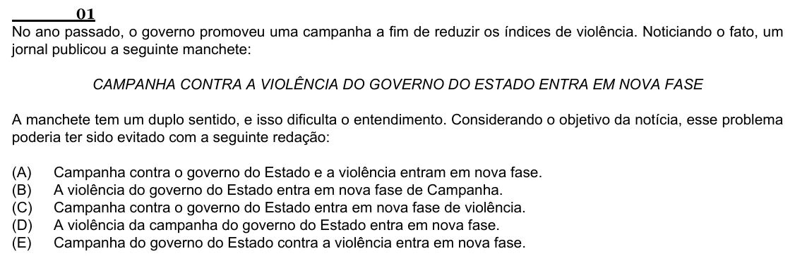

Texto extraído (pode conter ruído)

01  
No ano passado, o governo promoveu uma campanha a fim de reduzir os índices de violência. Noticiando o fato, um  
jornal publicou a seguinte manchete:  
CAMPANHA CONTRA A VIOLÊNCIA DO GOVERNO DO ESTADO ENTRA EM NOVA FASE  
A manchete tem um duplo sentido, e isso dificulta o entendimento. Considerando o objetivo da notícia, esse problema  
poderia ter sido evitado com a seguinte redação:  
(A)  
Campanha contra o governo do Estado e a violência entram em nova fase.  
(B)  
A violência do governo do Estado entra em nova fase de Campanha.  
(C)  
Campanha contra o governo do Estado entra em nova fase de violência.  
(D)  
A violência da campanha do governo do Estado entra em nova fase.  
(E)  
Campanha do governo do Estado contra a violência entra em nova fase.

