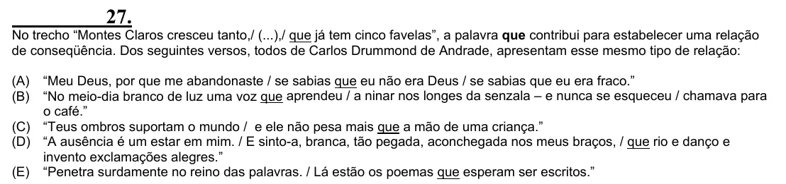

Texto extraído (pode conter ruído)

27.  
No trecho “Montes Claros cresceu tanto,/ (...),/ que já tem cinco favelas”, a palavra que contribui para estabelecer uma relação  
de conseqüência. Dos seguintes versos, todos de Carlos Drummond de Andrade, apresentam esse mesmo tipo de relação:  
(A)  
“Meu Deus, por que me abandonaste / se sabias que eu não era Deus / se sabias que eu era fraco.”  
(B)  
“No meio-dia branco de luz uma voz que aprendeu / a ninar nos longes da senzala – e nunca se esqueceu / chamava para  
o café.”  
(C) “Teus ombros suportam o mundo / e ele não pesa mais que a mão de uma criança.”  
(D) “A ausência é um estar em mim. / E sinto-a, branca, tão pegada, aconchegada nos meus braços, / que rio e danço e  
invento exclamações alegres.”  
(E) “Penetra surdamente no reino das palavras. / Lá estão os poemas que esperam ser escritos.”

