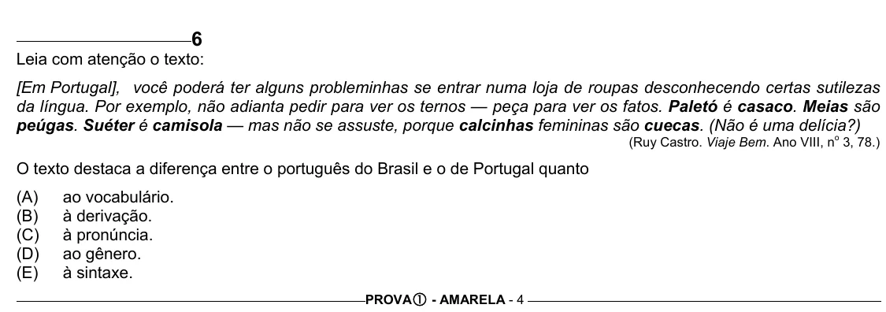

Texto extraído (pode conter ruído)

6  
Leia com atenção o texto:  
[Em Portugal], você poderá ter alguns probleminhas se entrar numa loja de roupas desconhecendo certas sutilezas  
da língua. Por exemplo, não adianta pedir para ver os ternos — peça para ver os fatos. Paletó é casaco. Meias são  
peúgas. Suéter é camisola — mas não se assuste, porque calcinhas femininas são cuecas. (Não é uma delícia?)  
(Ruy Castro. Viaje Bem. Ano VIII, n 3, 78.)  
o  
O texto destaca a diferença entre o português do Brasil e o de Portugal quanto  
(A)  
ao vocabulário.  
(B)  
à derivação.  
(C)  
à pronúncia.  
(D)  
ao gênero.  
(E)  
à sintaxe.  
PROVA c - AMARELA - 4

