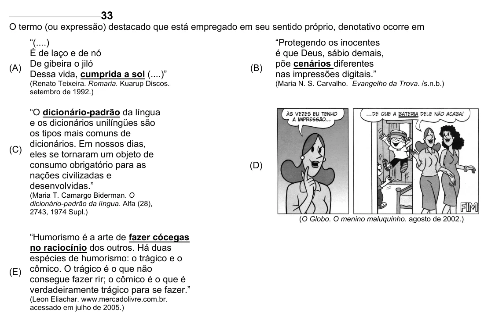

Texto extraído (pode conter ruído)

33  
O termo (ou expressão) destacado que está empregado em seu sentido próprio, denotativo ocorre em  
“(....)  
“Protegendo os inocentes  
É de laço e de nó  
é que Deus, sábio demais,  
(A) De gibeira o jiló  
põe cenários diferentes  
(B)  
Dessa vida, cumprida a sol (....)”  
nas impressões digitais.”  
(Renato Teixeira. Romaria. Kuarup Discos.  
(Maria N. S. Carvalho. Evangelho da Trova. /s.n.b.)  
setembro de 1992.)  
“O dicionário-padrão da língua  
e os dicionários unilíngües são  
os tipos mais comuns de  
dicionários. Em nossos dias,  
(C)  
eles se tornaram um objeto de  
consumo obrigatório para as  
(D)  
nações civilizadas e  
desenvolvidas.”  
(Maria T. Camargo Biderman. O  
dicionário-padrão da língua. Alfa (28),  
2743, 1974 Supl.)  
(O Globo. O menino maluquinho. agosto de 2002.)  
“Humorismo é a arte de fazer cócegas  
no raciocínio dos outros. Há duas  
espécies de humorismo: o trágico e o  
(E) cômico. O trágico é o que não  
consegue fazer rir; o cômico é o que é  
verdadeiramente trágico para se fazer.”  
(Leon Eliachar. www.mercadolivre.com.br.  
acessado em julho de 2005.)

