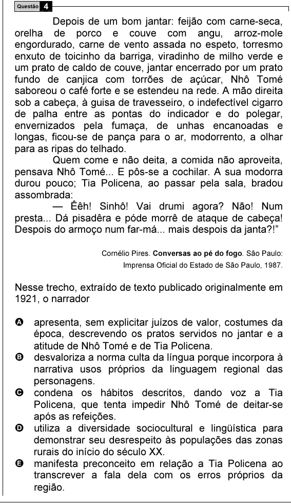

Texto extraído (pode conter ruído)

4  
Questão  
Depois de um bom jantar: feijão com carne-seca,  
orelha de porco e couve com angu, arroz-mole  
engordurado, carne de vento assada no espeto, torresmo  
enxuto de toicinho da barriga, viradinho de milho verde e  
um prato de caldo de couve, jantar encerrado por um prato  
fundo de canjica com torrões de açúcar, Nhô Tomé  
saboreou o café forte e se estendeu na rede. A mão direita  
sob a cabeça, à guisa de travesseiro, o indefectível cigarro  
de palha entre as pontas do indicador e do polegar,  
envernizados pela fumaça, de unhas encanoadas e  
longas, ficou-se de pança para o ar, modorrento, a olhar  
para as ripas do telhado.  
Quem come e não deita, a comida não aproveita,  
pensava Nhô Tomé... E pôs-se a cochilar. A sua modorra  
durou pouco; Tia Policena, ao passar pela sala, bradou  
assombrada:  
— Êêh! Sinhô! Vai drumi agora? Não! Num  
presta... Dá pisadêra e póde morrê de ataque de cabeça!  
Despois do armoço num far-má... mais despois da janta?!”  
Cornélio Pires. Conversas ao pé do fogo. São Paulo:  
Imprensa Oficial do Estado de São Paulo, 1987.  
Nesse trecho, extraído de texto publicado originalmente em  
1921, o narrador  
A apresenta, sem explicitar juízos de valor, costumes da  
época, descrevendo os pratos servidos no jantar e a  
atitude de Nhô Tomé e de Tia Policena.  
B desvaloriza a norma culta da língua porque incorpora à  
narrativa usos próprios da linguagem regional das  
personagens.  
C condena os hábitos descritos, dando voz a Tia  
Policena, que tenta impedir Nhô Tomé de deitar-se  
após as refeições.  
D utiliza a diversidade sociocultural e lingüística para  
demonstrar seu desrespeito às populações das zonas  
rurais do início do século XX.  
E manifesta preconceito em relação a Tia Policena ao  
transcrever a fala dela com os erros próprios da  
região.

