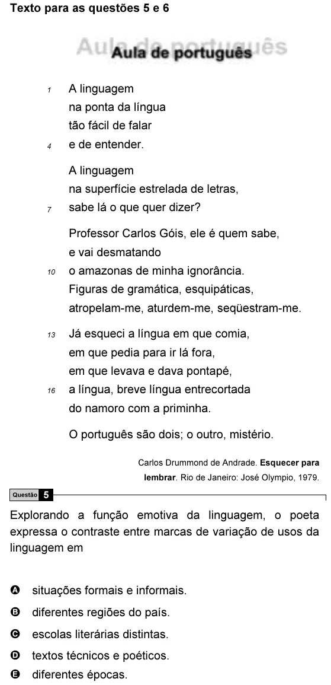

Texto extraído (pode conter ruído)

Texto para as questões 5 e 6  
A linguagem  
1  
na ponta da língua  
tão fácil de falar  
e de entender.  
4  
A linguagem  
na superfície estrelada de letras,  
7  
sabe lá o que quer dizer?  
Professor Carlos Góis, ele é quem sabe,  
e vai desmatando  
10  
o amazonas de minha ignorância.  
Figuras de gramática, esquipáticas,  
atropelam-me, aturdem-me, seqüestram-me.  
13  
Já esqueci a língua em que comia,  
em que pedia para ir lá fora,  
em que levava e dava pontapé,  
16  
a língua, breve língua entrecortada  
do namoro com a priminha.  
O português são dois; o outro, mistério.  
Carlos Drummond de Andrade. Esquecer para  
lembrar. Rio de Janeiro: José Olympio, 1979.  
Questão  
5  
Explorando a função emotiva da linguagem, o poeta  
expressa o contraste entre marcas de variação de usos da  
linguagem em  
A situações formais e informais.  
B diferentes regiões do país.  
C escolas literárias distintas.  
D textos técnicos e poéticos.  
E diferentes épocas.

