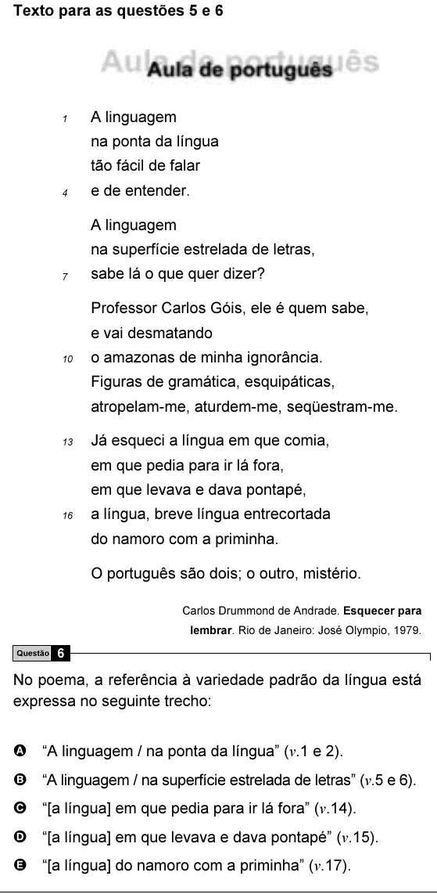

Texto extraído (pode conter ruído)

Texto para as questões 5 e 6  
A linguagem  
1  
na ponta da língua  
tão fácil de falar  
e de entender.  
4  
A linguagem  
na superfície estrelada de letras,  
7  
sabe lá o que quer dizer?  
Professor Carlos Góis, ele é quem sabe,  
e vai desmatando  
10  
o amazonas de minha ignorância.  
Figuras de gramática, esquipáticas,  
atropelam-me, aturdem-me, seqüestram-me.  
13  
Já esqueci a língua em que comia,  
em que pedia para ir lá fora,  
em que levava e dava pontapé,  
16  
a língua, breve língua entrecortada  
do namoro com a priminha.  
O português são dois; o outro, mistério.  
Carlos Drummond de Andrade. Esquecer para  
lembrar. Rio de Janeiro: José Olympio, 1979.  
6  
Questão  
No poema, a referência à variedade padrão da língua está  
expressa no seguinte trecho:  
A “A linguagem / na ponta da língua” (v.1 e 2).  
B “A linguagem / na superfície estrelada de letras” (v.5 e 6).  
C “[a língua] em que pedia para ir lá fora” (v.14).  
D “[a língua] em que levava e dava pontapé” (v.15).  
E “[a língua] do namoro com a priminha” (v.17).

