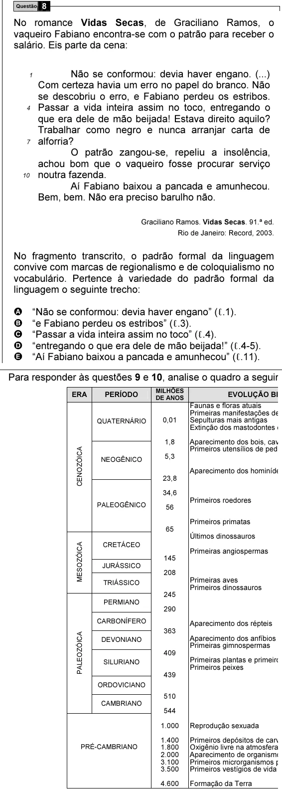

Texto extraído (pode conter ruído)

8  
Questão  
No romance Vidas Secas, de Graciliano Ramos, o  
vaqueiro Fabiano encontra-se com o patrão para receber o  
salário. Eis parte da cena:  
Não se conformou: devia haver engano. (...)  
1  
Com certeza havia um erro no papel do branco. Não  
se descobriu o erro, e Fabiano perdeu os estribos.  
4  
Passar a vida inteira assim no toco, entregando o  
que era dele de mão beijada! Estava direito aquilo?  
Trabalhar como negro e nunca arranjar carta de  
7  
alforria?  
O patrão zangou-se, repeliu a insolência,  
achou bom que o vaqueiro fosse procurar serviço  
10  
noutra fazenda.  
Aí Fabiano baixou a pancada e amunhecou.  
Bem, bem. Não era preciso barulho não.  
Graciliano Ramos. Vidas Secas. 91.ª ed.  
Rio de Janeiro: Record, 2003.  
No fragmento transcrito, o padrão formal da linguagem  
convive com marcas de regionalismo e de coloquialismo no  
vocabulário. Pertence à variedade do padrão formal da  
linguagem o seguinte trecho:  
A  
“Não se conformou: devia haver engano” (ℓ.1).  
B  
“e Fabiano perdeu os estribos” (ℓ.3).  
C  
“Passar a vida inteira assim no toco” (ℓ.4).  
D  
“entregando o que era dele de mão beijada!” (ℓ.4-5).  
E  
“Aí Fabiano baixou a pancada e amunhecou” (ℓ.11).  
Para responder às questões 9 e 10, analise o quadro a seguir, que esquematiza a história da Terra.  
MILHÕES  
ERA  
PERÍODO  
EVOLUÇÃO BIOLÓGICA  
DE ANOS  
Faunas e floras atuais  
Primeiras manifestações de arte  
QUATERNÁRIO  
0,01  
Sepulturas mais antigas  
Extinção dos mastodontes e dinotérios  
1,8  
Aparecimento dos bois, cavalos e veados  
CENOZÓICA  
Primeiros utensílios de pedra  
5,3  
NEOGÊNICO  
Aparecimento dos hominídeos  
23,8  
34,6  
Primeiros roedores  
PALEOGÊNICO  
56  
Primeiros primatas  
65  
Últimos dinossauros  
MESOZÓICA  
CRETÁCEO  
Primeiras angiospermas  
145  
JURÁSSICO  
208  
TRIÁSSICO  
Primeiras aves  
Primeiros dinossauros  
245  
PERMIANO  
290  
CARBONÍFERO  
Aparecimento dos répteis  
363  
PALEOZÓICA  
DEVONIANO  
Aparecimento dos anfíbios  
Primeiras gimnospermas  
409  
Primeiras plantas e primeiros animais terrestres  
SILURIANO  
Primeiros peixes  
439  
ORDOVICIANO  
510  
CAMBRIANO  
544  
1.000  
Reprodução sexuada  
1.400  
Primeiros depósitos de carvão (algas)  
PRÉ-CAMBRIANO  
1.800  
Oxigênio livre na atmosfera  
2.000  
Aparecimento de organismos eucariontes  
3.100  
Primeiros microrganismos procariontes  
3.500  
Primeiros vestígios de vida  
4.600  
Formação da Terra

