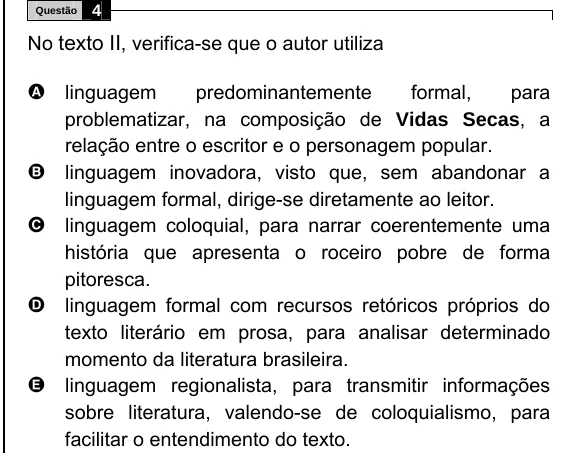

Texto extraído (pode conter ruído)

Questão  
4  
No texto II , verifica-se que o autor utiliza  
A linguagem  
predominantemente  
formal,  
para  
problematizar, na composição de Vidas Secas, a  
relação entre o escritor e o personagem popular.  
B  
linguagem inovadora, visto que, sem abandonar a  
linguagem formal, dirige-se diretamente ao leitor.  
linguagem coloquial, para narrar coerentemente uma  
C  
história que apresenta o roceiro pobre de forma  
pitoresca.  
D  
linguagem formal com recursos retóricos próprios do  
texto literário em prosa, para analisar determinado  
momento da literatura brasileira.  
E  
linguagem regionalista, para transmitir informações  
sobre literatura, valendo-se de coloquialismo, para  
facilitar o entendimento do texto.

