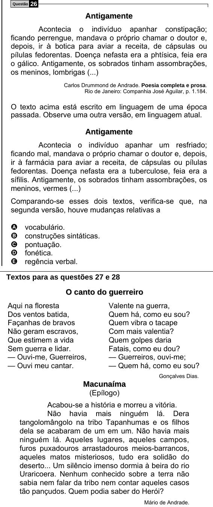

Texto extraído (pode conter ruído)

Questão  
26  
A n t i g a m e n t e  
Acontecia o indivíduo apanhar constipação;  
ficando perrengue, mandava o próprio chamar o doutor e,  
depois, ir à botica para aviar a receita, de cápsulas ou  
pílulas fedorentas. Doença nefasta era a phtísica, feia era  
o gálico. Antigamente, os sobrados tinham assombrações,  
os meninos, lombrigas (...)  
Carlos Drummond de Andrade. Poesia completa e prosa.  
Rio de Janeiro: Companhia José Aguilar, p. 1.184.  
O texto acima está escrito em linguagem de uma época  
passada. Observe uma outra versão, em linguagem atual.  
A n t i g a m e n t e  
Acontecia o indivíduo apanhar um resfriado;  
ficando mal, mandava o próprio chamar o doutor e, depois,  
ir à farmácia para aviar a receita, de cápsulas ou pílulas  
fedorentas. Doença nefasta era a tuberculose, feia era a  
sífilis. Antigamente, os sobrados tinham assombrações, os  
meninos, vermes (...)  
Comparando-se esses dois textos, verifica-se que, na  
segunda versão, houve mudanças relativas a  
A  
vocabulário.  
B  
construções sintáticas.  
pontuação.  
C  
D  
fonética.  
E  
regência verbal.  
Textos para as questões 27 e 28  
O c a n t o d o g u e r r e i r o  
Aqui na floresta  
Valente na guerra,  
Dos ventos batida,  
Quem há, como eu sou?  
Façanhas de bravos  
Quem vibra o tacape  
Não geram escravos,  
Com mais valentia?  
Que estimem a vida  
Quem golpes daria  
Sem guerra e lidar.  
Fatais, como eu dou?  
— Ouvi-me, Guerreiros,  
— Guerreiros, ouvi-me;  
— Ouvi meu cantar.  
— Quem há, como eu sou?  
Gonçalves Dias.  
M a c u n a í m a  
(Epílogo)  
Acabou-se a história e morreu a vitória.  
Não havia mais ninguém lá. Dera  
tangolomângolo na tribo Tapanhumas e os filhos  
dela se acabaram de um em um. Não havia mais  
ninguém lá. Aqueles lugares, aqueles campos,  
furos puxadouros arrastadouros meios-barrancos,  
aqueles matos misteriosos, tudo era solidão do  
deserto... Um silêncio imenso dormia à beira do rio  
Uraricoera. Nenhum conhecido sobre a terra não  
sabia nem falar da tribo nem contar aqueles casos  
tão pançudos. Quem podia saber do Herói?  
Mário de Andrade.

