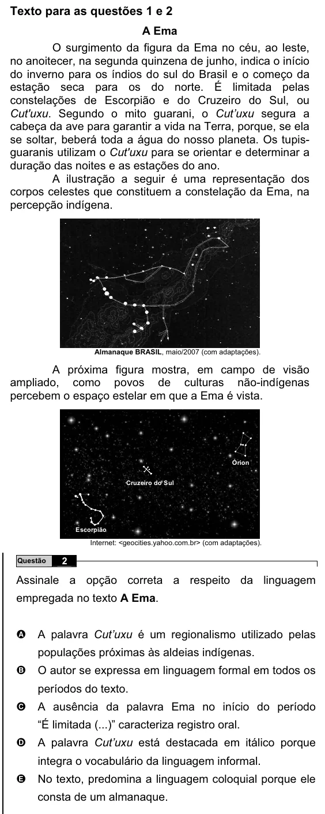

Texto extraído (pode conter ruído)

Texto para as questões 1 e 2  
A Ema  
O surgimento da figura da Ema no céu, ao leste,  
no anoitecer, na segunda quinzena de junho, indica o início  
do inverno para os índios do sul do Brasil e o começo da  
estação seca para os do norte. É limitada pelas  
constelações de Escorpião e do Cruzeiro do Sul, ou  
Cut'uxu. Segundo o mito guarani, o Cut’uxu segura a  
cabeça da ave para garantir a vida na Terra, porque, se ela  
se soltar, beberá toda a água do nosso planeta. Os tupis-  
guaranis utilizam o Cut'uxu para se orientar e determinar a  
duração das noites e as estações do ano.  
A ilustração a seguir é uma representação dos  
corpos celestes que constituem a constelação da Ema, na  
percepção indígena.  
Almanaque BRASIL, maio/2007 (com adaptações).  
A próxima figura mostra, em campo de visão  
ampliado, como povos de culturas não-indígenas  
percebem o espaço estelar em que a Ema é vista.  
Órion  
Cruzeiro do Sul  
Escorpião  
Internet: <geocities.yahoo.com.br> (com adaptações).  
2  
Questão  
Assinale a opção correta a respeito da linguagem  
empregada no texto A Ema.  
A palavra Cut’uxu é um regionalismo utilizado pelas  
A  
populações próximas às aldeias indígenas.  
O autor se expressa em linguagem formal em todos os  
B  
períodos do texto.  
A ausência da palavra Ema no início do período  
C  
“É limitada (...)” caracteriza registro oral.  
A palavra Cut’uxu está destacada em itálico porque  
D  
integra o vocabulário da linguagem informal.  
No texto, predomina a linguagem coloquial porque ele  
E  
consta de um almanaque.

