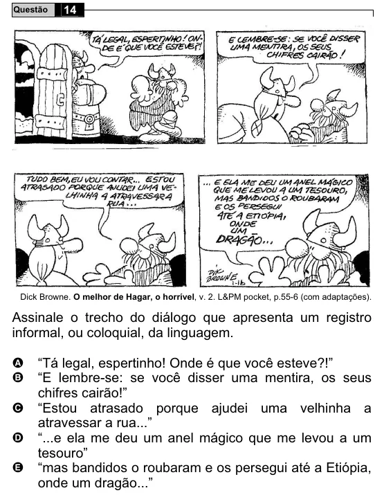

Texto extraído (pode conter ruído)

14  
Questão  
Dick Browne. O melhor de Hagar, o horrível, v. 2. L&PM pocket, p.55-6 (com adaptações).  
Assinale o trecho do diálogo que apresenta um registro  
informal, ou coloquial, da linguagem.  
A  
“Tá legal, espertinho! Onde é que você esteve?!”  
“E lembre-se: se você disser uma mentira, os seus  
B  
chifres cairão!”  
“Estou atrasado porque ajudei uma velhinha a  
C  
atravessar a rua...”  
D  
“...e ela me deu um anel mágico que me levou a um  
tesouro”  
E  
“mas bandidos o roubaram e os persegui até a Etiópia,  
onde um dragão...”

