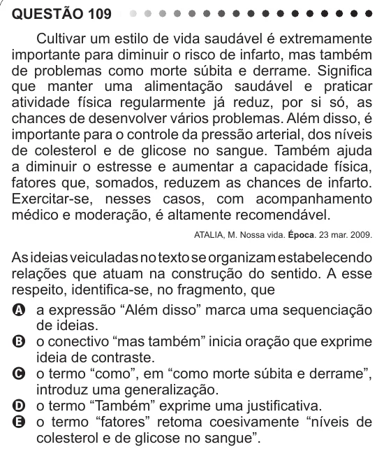

Texto extraído (pode conter ruído)

QUESTÃO 109  
Cultivar um estilo de vida saudável é extremamente  
importante para diminuir o risco de infarto, mas também  
de problemas como morte súbita e derrame. Significa  
que manter uma alimentação saudável e praticar  
atividade física regularmente já reduz, por si só, as  
chances de desenvolver vários problemas. Além disso, é  
importante para o controle da pressão arterial, dos níveis  
de colesterol e de glicose no sangue. Também ajuda  
a diminuir o estresse e aumentar a capacidade física,  
fatores que, somados, reduzem as chances de infarto.  
Exercitar-se, nesses casos, com acompanhamento  
médico e moderação, é altamente recomendável.  
ATALIA, M. Nossa vida. Época. 23 mar. 2009.  
As ideias veiculadas no texto se organizam estabelecendo  
relações que atuam na construção do sentido. A esse  
respeito, identifica-se, no fragmento, que  
A a expressão “Além disso” marca uma sequenciação  
de ideias.  
B o conectivo “mas também” inicia oração que exprime  
ideia de contraste.  
C o termo “como”, em “como morte súbita e derrame”,  
introduz uma generalização.  
D o termo “Também” exprime uma justificativa.  
E o termo “fatores” retoma coesivamente “níveis de  
colesterol e de glicose no sangue”.

