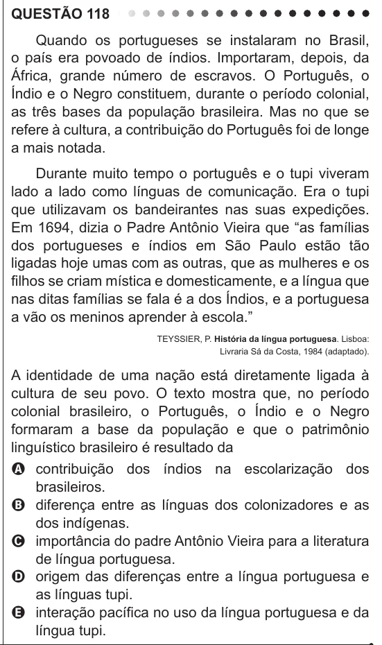

Texto extraído (pode conter ruído)

QUESTÃO 118  
Quando os portugueses se instalaram no Brasil,  
o país era povoado de índios. Importaram, depois, da  
África, grande número de escravos. O Português, o  
Índio e o Negro constituem, durante o período colonial,  
as três bases da população brasileira. Mas no que se  
refere à cultura, a contribuição do Português foi de longe  
a mais notada.  
Durante muito tempo o português e o tupi viveram  
lado a lado como línguas de comunicação. Era o tupi  
que utilizavam os bandeirantes nas suas expedições.  
Em 1694, dizia o Padre Antônio Vieira que “as famílias  
dos portugueses e índios em São Paulo estão tão  
ligadas hoje umas com as outras, que as mulheres e os  
filhos se criam mística e domesticamente, e a língua que  
nas ditas famílias se fala é a dos Índios, e a portuguesa  
a vão os meninos aprender à escola.”  
TEYSSIER, P. História da língua portuguesa. Lisboa:  
Livraria Sá da Costa, 1984 (adaptado).  
A identidade de uma nação está diretamente ligada à  
cultura de seu povo. O texto mostra que, no período  
colonial brasileiro, o Português, o Índio e o Negro  
formaram a base da população e que o patrimônio  
linguístico brasileiro é resultado da  
A contribuição dos índios na escolarização dos  
brasileiros.  
B diferença entre as línguas dos colonizadores e as  
dos indígenas.  
C importância do padre Antônio Vieira para a literatura  
de língua portuguesa.  
D origem das diferenças entre a língua portuguesa e  
as línguas tupi.  
E interação pacífica no uso da língua portuguesa e da  
língua tupi.

