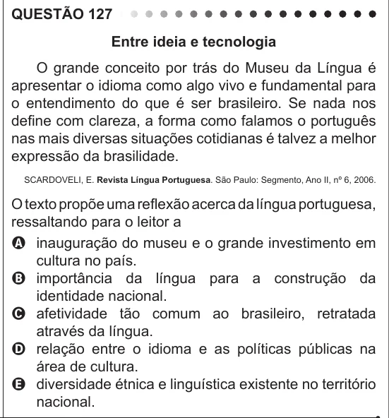

Texto extraído (pode conter ruído)

QUESTÃO 127  
Entre ideia e tecnologia  
O grande conceito por trás do Museu da Língua é  
apresentar o idioma como algo vivo e fundamental para  
o entendimento do que é ser brasileiro. Se nada nos  
define com clareza, a forma como falamos o português  
nas mais diversas situações cotidianas é talvez a melhor  
expressão da brasilidade.  
SCARDOVELI, E. Revista Língua Portuguesa. São Paulo: Segmento, Ano II, nº 6, 2006.  
O texto propõe uma reflexão acerca da língua portuguesa,  
ressaltando para o leitor a  
A inauguração do museu e o grande investimento em  
cultura no país.  
B importância da língua para a construção da  
identidade nacional.  
C afetividade tão comum ao brasileiro, retratada  
através da língua.  
D relação entre o idioma e as políticas públicas na  
área de cultura.  
E diversidade étnica e linguística existente no território  
nacional.

