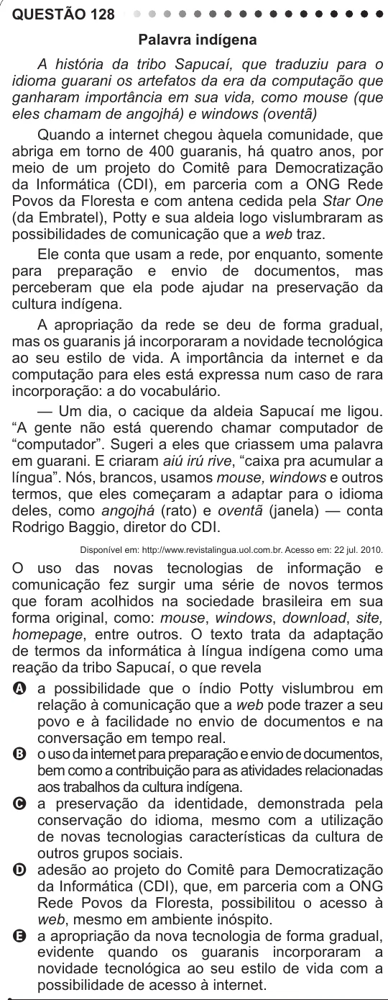

Texto extraído (pode conter ruído)

QUESTÃO 128  
Palavra indígena  
A história da tribo Sapucaí, que traduziu para o  
idioma guarani os artefatos da era da computação que  
ganharam importância em sua vida, como mouse (que  
eles chamam de angojhá) e windows (oventã)  
Quando a internet chegou àquela comunidade, que  
abriga em torno de 400 guaranis, há quatro anos, por  
meio de um projeto do Comitê para Democratização  
da Informática (CDI), em parceria com a ONG Rede  
Povos da Floresta e com antena cedida pela Star One  
(da Embratel), Potty e sua aldeia logo vislumbraram as  
possibilidades de comunicação que a web traz.  
Ele conta que usam a rede, por enquanto, somente  
para preparação e envio de documentos, mas  
perceberam que ela pode ajudar na preservação da  
cultura indígena.  
A apropriação da rede se deu de forma gradual,  
mas os guaranis já incorporaram a novidade tecnológica  
ao seu estilo de vida. A importância da internet e da  
computação para eles está expressa num caso de rara  
incorporação: a do vocabulário.  
— Um dia, o cacique da aldeia Sapucaí me ligou.  
“A gente não está querendo chamar computador de  
“computador”. Sugeri a eles que criassem uma palavra  
em guarani. E criaram aiú irú rive, “caixa pra acumular a  
língua”. Nós, brancos, usamos mouse, windows e outros  
termos, que eles começaram a adaptar para o idioma  
deles, como angojhá (rato) e oventã (janela) — conta  
Rodrigo Baggio, diretor do CDI.  
Disponível em: http://www.revistalingua.uol.com.br. Acesso em: 22 jul. 2010.  
O uso das novas tecnologias de informação e  
comunicação fez surgir uma série de novos termos  
que foram acolhidos na sociedade brasileira em sua  
forma original, como: mouse, windows, download, site,  
homepage, entre outros. O texto trata da adaptação  
de termos da informática à língua indígena como uma  
reação da tribo Sapucaí, o que revela  
A a possibilidade que o índio Potty vislumbrou em  
relação à comunicação que a web pode trazer a seu  
povo e à facilidade no envio de documentos e na  
conversação em tempo real.  
B o uso da internet para preparação e envio de documentos,  
bem como a contribuição para as atividades relacionadas  
aos trabalhos da cultura indígena.  
C a preservação da identidade, demonstrada pela  
conservação do idioma, mesmo com a utilização  
de novas tecnologias características da cultura de  
outros grupos sociais.  
D adesão ao projeto do Comitê para Democratização  
da Informática (CDI), que, em parceria com a ONG  
Rede Povos da Floresta, possibilitou o acesso à  
web, mesmo em ambiente inóspito.  
E a apropriação da nova tecnologia de forma gradual,  
evidente quando os guaranis incorporaram a  
novidade tecnológica ao seu estilo de vida com a  
possibilidade de acesso à internet.

