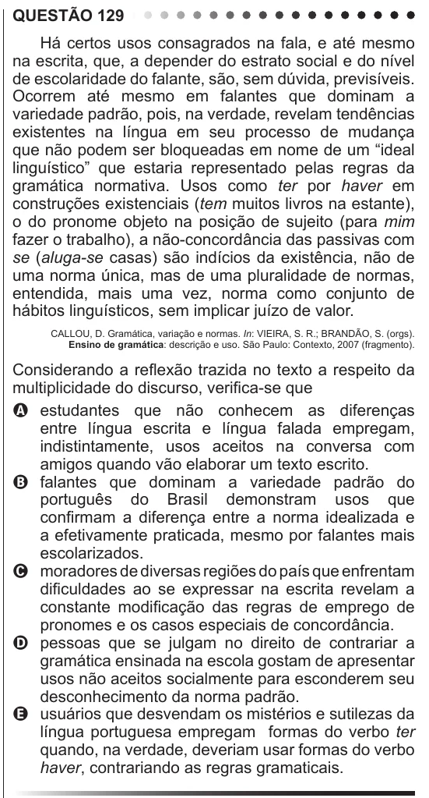

Texto extraído (pode conter ruído)

QUESTÃO 129  
Há certos usos consagrados na fala, e até mesmo  
na escrita, que, a depender do estrato social e do nível  
de escolaridade do falante, são, sem dúvida, previsíveis.  
Ocorrem até mesmo em falantes que dominam a  
variedade padrão, pois, na verdade, revelam tendências  
existentes na língua em seu processo de mudança  
que não podem ser bloqueadas em nome de um “ideal  
linguístico” que estaria representado pelas regras da  
gramática normativa. Usos como ter por haver em  
construções existenciais (tem muitos livros na estante),  
o do pronome objeto na posição de sujeito (para mim  
fazer o trabalho), a não-concordância das passivas com  
se (aluga-se casas) são indícios da existência, não de  
uma norma única, mas de uma pluralidade de normas,  
entendida, mais uma vez, norma como conjunto de  
hábitos linguísticos, sem implicar juízo de valor.  
CALLOU, D. Gramática, variação e normas. In: VIEIRA, S. R.; BRANDÃO, S. (orgs).  
Ensino de gramática: descrição e uso. São Paulo: Contexto, 2007 (fragmento).  
Considerando a reflexão trazida no texto a respeito da  
multiplicidade do discurso, verifica-se que  
A estudantes que não conhecem as diferenças  
entre língua escrita e língua falada empregam,  
indistintamente, usos aceitos na conversa com  
amigos quando vão elaborar um texto escrito.  
B falantes que dominam a variedade padrão do  
português do Brasil demonstram usos que  
confirmam a diferença entre a norma idealizada e  
a efetivamente praticada, mesmo por falantes mais  
escolarizados.  
C moradores de diversas regiões do país que enfrentam  
dificuldades ao se expressar na escrita revelam a  
constante modificação das regras de emprego de  
pronomes e os casos especiais de concordância.  
D pessoas que se julgam no direito de contrariar a  
gramática ensinada na escola gostam de apresentar  
usos não aceitos socialmente para esconderem seu  
desconhecimento da norma padrão.  
E usuários que desvendam os mistérios e sutilezas da  
língua portuguesa empregam formas do verbo ter  
quando, na verdade, deveriam usar formas do verbo  
haver, contrariando as regras gramaticais.

