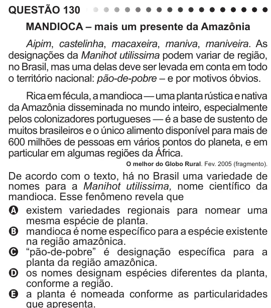

Texto extraído (pode conter ruído)

QUESTÃO 130  
MANDIOCA – mais um presente da Amazônia  
Aipim, castelinha, macaxeira, maniva, maniveira. As  
designações da Manihot utilissima podem variar de região,  
no Brasil, mas uma delas deve ser levada em conta em todo  
o território nacional: pão-de-pobre – e por motivos óbvios.  
Rica em fécula, a mandioca — uma planta rústica e nativa  
da Amazônia disseminada no mundo inteiro, especialmente  
pelos colonizadores portugueses — é a base de sustento de  
muitos brasileiros e o único alimento disponível para mais de  
600 milhões de pessoas em vários pontos do planeta, e em  
particular em algumas regiões da África.  
O melhor do Globo Rural. Fev. 2005 (fragmento).  
De acordo com o texto, há no Brasil uma variedade de  
nomes para a Manihot utilissima, nome científico da  
mandioca. Esse fenômeno revela que  
A existem variedades regionais para nomear uma  
mesma espécie de planta.  
B mandioca é nome específico para a espécie existente  
na região amazônica.  
C “pão-de-pobre” é designação específica para a  
planta da região amazônica.  
D os nomes designam espécies diferentes da planta,  
conforme a região.  
E a planta é nomeada conforme as particularidades

