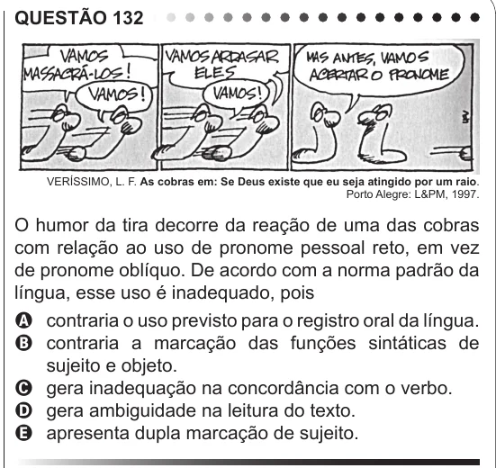

Texto extraído (pode conter ruído)

QUESTÃO 132  
VERÍSSIMO, L. F. As cobras em: Se Deus existe que eu seja atingido por um raio.  
Porto Alegre: L&PM, 1997.  
O humor da tira decorre da reação de uma das cobras  
com relação ao uso de pronome pessoal reto, em vez  
de pronome oblíquo. De acordo com a norma padrão da  
língua, esse uso é inadequado, pois  
A contraria o uso previsto para o registro oral da língua.  
B contraria a marcação das funções sintáticas de  
sujeito e objeto.  
C gera inadequação na concordância com o verbo.  
D gera ambiguidade na leitura do texto.  
E apresenta dupla marcação de sujeito.  
Imagem para as questões 133 e 134

