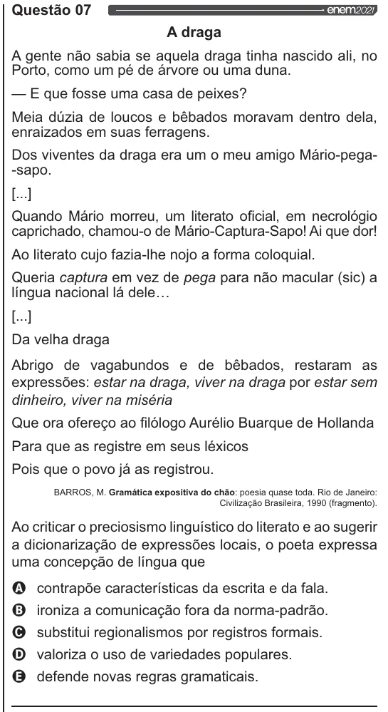

Texto extraído (pode conter ruído)

Questão 07  
A draga  
A gente não sabia se aquela draga tinha nascido ali, no  
Porto, como um pé de árvore ou uma duna.  
— E que fosse uma casa de peixes?  
Meia dúzia de loucos e bêbados moravam dentro dela,  
enraizados em suas ferragens.  
Dos viventes da draga era um o meu amigo Mário-pega-  
-sapo.  
[.]  
Quando Mário morreu, um literato oficial, em necrológio  
caprichado, chamou-o de Mário-Captura-Sapo! Ai que dor!  
Ao literato cujo fazia-lhe nojo a forma coloquial.  
Queria captura em vez de pega para não macular (sic) a  
língua nacional lá dele...  
[...]  
Da velha draga  
Abrigo de vagabundos e de bêbados, restaram as  
expressões: estar na draga, viver na draga por estar sem  
dinheiro, viver na miséria  
Que ora ofereço ao filólogo Aurélio Buarque de Hollanda  
Para que as registre em seus léxicos  
Pois que o povo já as registrou.  
BARROS, M. Gramática expositiva do chão: poesia quase toda. Rio de Janeiro:  
Civilização Brasileira, 1990 (fragmento).  
Ao criticar o preciosismo linguístico do literato e ao sugerir  
a dicionarização de expressões locais, o poeta expressa  
uma concepção de língua que  
OQ contrapõe características da escrita e da fala.  
VOVO  
ironiza a comunicação fora da norma-padrão.  
substitui regionalismos por registros formais.  
valoriza o uso de variedades populares.  
defende novas regras gramaticais.

