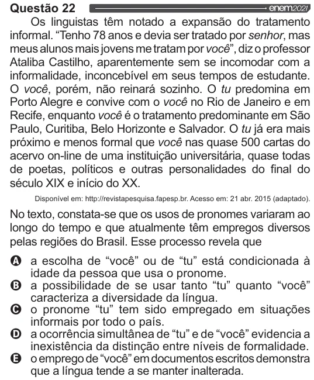

Texto extraído (pode conter ruído)

Questão 22 202  
Os linguistas têm notado a expansão do tratamento  
informal. “Tenho 78 anos e devia ser tratado por senhor, mas  
meus alunos mais jovens me tratam por você”, diz o professor  
Ataliba Castilho, aparentemente sem se incomodar com a  
informalidade, inconcebível em seus tempos de estudante.  
O você, porém, não reinará sozinho. O tu predomina em  
Porto Alegre e convive com o você no Rio de Janeiro e em  
Recife, enquanto você é o tratamento predominante em São  
Paulo, Curitiba, Belo Horizonte e Salvador. O tu já era mais  
próximo e menos formal que você nas quase 500 cartas do  
acervo on-line de uma instituição universitária, quase todas  
de poetas, políticos e outras personalidades do final do  
século XIX e início do XX.  
Disponível em: http:llrevistapesquisa.fapesp.br. Acesso em: 21 abr. 2015 (adaptado).  
No texto, constata-se que os usos de pronomes variaram ao  
longo do tempo e que atualmente têm empregos diversos  
pelas regiões do Brasil. Esse processo revela que  
oo vo  
a escolha de “você” ou de “tu” está condicionada à  
idade da pessoa que usa o pronome.  
a possibilidade de se usar tanto “tu” quanto “você”  
caracteriza a diversidade da língua.  
o pronome “tu” tem sido empregado em situações  
informais por todo o país.  
a ocorrência simultânea de “tu” e de “você” evidencia a  
inexistência da distinção entre níveis de formalidade.  
o emprego de “você” em documentos escritos demonstra  
que a língua tende a se manter inalterada.

