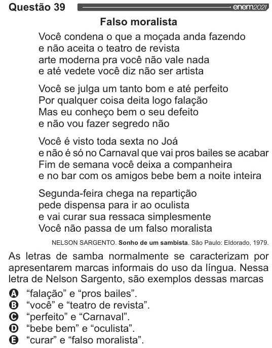

Texto extraído (pode conter ruído)

Questão 39  
Falso moralista  
Você condena o que a moçada anda fazendo  
e não aceita o teatro de revista  
arte moderna pra você não vale nada  
e até vedete você diz não ser artista  
Você se julga um tanto bom e até perfeito  
Por qualquer coisa deita logo falação  
Mas eu conheço bem o seu defeito  
e não vou fazer segredo não  
Você é visto toda sexta no Joá  
e não é só no Carnaval que vai pros bailes se acabar  
Fim de semana você deixa a companheira  
e no bar com os amigos bebe bem a noite inteira  
Segunda-feira chega na repartição  
pede dispensa para ir ao oculista  
e vai curar sua ressaca simplesmente  
Você não passa de um falso moralista  
NELSON SARGENTO. Sonho de um sambista. São Paulo: Eldorado, 1979.  
As letras de samba normalmente se caracterizam por  
apresentarem marcas informais do uso da língua. Nessa  
letra de Nelson Sargento, são exemplos dessas marcas  
VOVOO  
“falação” e “pros bailes”.  
“você” e “teatro de revista”.  
“perfeito” e “Carnaval”.  
“bebe bem” e “oculista”.  
“curar” e “falso moralista”.

