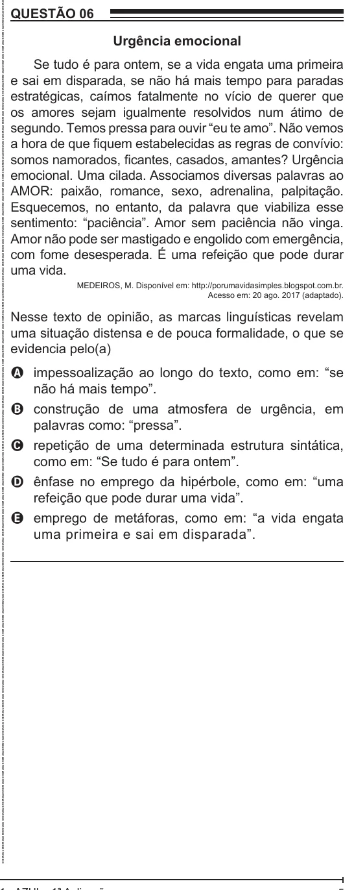

Texto extraído (pode conter ruído)

QUESTÃO 06  
Urgência emocional  
Se tudo é para ontem, se a vida engata uma primeira  
e sai em disparada, se não há mais tempo para paradas  
estratégicas, caímos fatalmente no vício de querer que  
os amores sejam igualmente resolvidos num átimo de  
segundo. Temos pressa para ouvir “eu te amo”. Não vemos  
a hora de que fiquem estabelecidas as regras de convívio:  
somos namorados, ficantes, casados, amantes? Urgência  
emocional. Uma cilada. Associamos diversas palavras ao  
AMOR: paixão, romance, sexo, adrenalina, palpitação.  
Esquecemos, no entanto, da palavra que viabiliza esse  
sentimento: “paciência”. Amor sem paciência não vinga.  
Amor não pode ser mastigado e engolido com emergência,  
com fome desesperada. É uma refeição que pode durar  
uma vida.  
MEDEIROS, M. Disponível em: http://porumavidasimples.blogspot.com.br.  
Acesso em: 20 ago. 2017 (adaptado).  
Nesse texto de opinião, as marcas linguísticas revelam  
uma situação distensa e de pouca formalidade, o que se  
evidencia pelo(a)  
A impessoalização ao longo do texto, como em: “se  
não há mais tempo”.  
B construção de uma atmosfera de urgência, em  
palavras como: “pressa”.  
C repetição de uma determinada estrutura sintática,  
como em: “Se tudo é para ontem”.  
D ênfase no emprego da hipérbole, como em: “uma  
refeição que pode durar uma vida”.  
E emprego de metáforas, como em: “a vida engata  
uma primeira e sai em disparada”.

