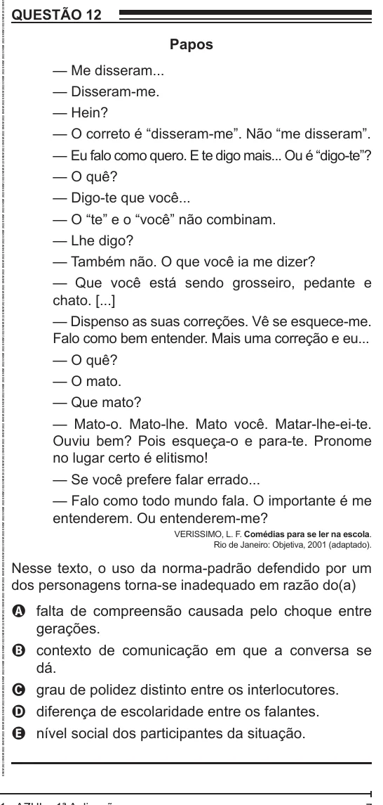

Texto extraído (pode conter ruído)

QUESTÃO 12  
Papos  
— Me disseram...  
— Disseram-me.  
— Hein?  
— O correto é “disseram-me”. Não “me disseram”.  
— Eu falo como quero. E te digo mais... Ou é “digo-te”?  
— O quê?  
— Digo-te que você...  
— O “te” e o “você” não combinam.  
— Lhe digo?  
— Também não. O que você ia me dizer?  
— Que você está sendo grosseiro, pedante e  
chato. [...]  
— Dispenso as suas correções. Vê se esquece-me.  
Falo como bem entender. Mais uma correção e eu...  
— O quê?  
— O mato.  
— Que mato?  
— Mato-o. Mato-lhe. Mato você. Matar-lhe-ei-te.  
Ouviu bem? Pois esqueça-o e para-te. Pronome  
no lugar certo é elitismo!  
— Se você prefere falar errado...  
— Falo como todo mundo fala. O importante é me  
entenderem. Ou entenderem-me?  
VERISSIMO, L. F. Comédias para se ler na escola.  
Rio de Janeiro: Objetiva, 2001 (adaptado).  
Nesse texto, o uso da norma-padrão defendido por um  
dos personagens torna-se inadequado em razão do(a)  
A falta de compreensão causada pelo choque entre  
gerações.  
B contexto de comunicação em que a conversa se  
dá.  
C grau de polidez distinto entre os interlocutores.  
D diferença de escolaridade entre os falantes.  
E nível social dos participantes da situação.

