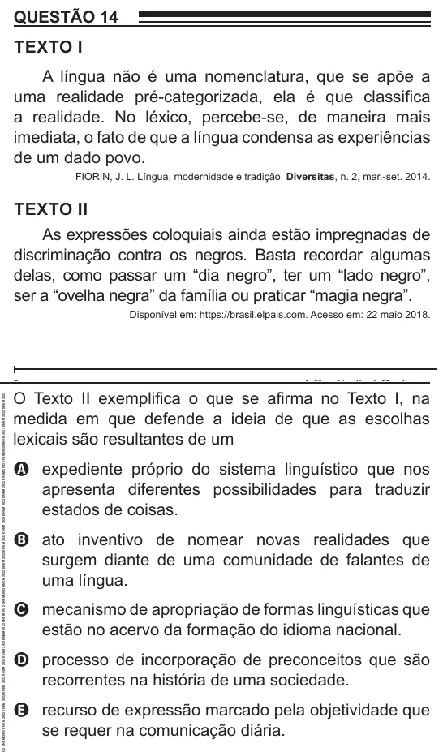

Texto extraído (pode conter ruído)

QUESTÃO 14  
TEXTO I  
A língua não é uma nomenclatura, que se apõe a  
uma realidade pré-categorizada, ela é que classifica  
a realidade. No léxico, percebe-se, de maneira mais  
imediata, o fato de que a língua condensa as experiências  
de um dado povo.  
FIORIN, J. L. Língua, modernidade e tradição. Diversitas, n. 2, mar.-set. 2014.  
TEXTO II  
As expressões coloquiais ainda estão impregnadas de  
discriminação contra os negros. Basta recordar algumas  
delas, como passar um “dia negro”, ter um “lado negro”,  
ser a “ovelha negra” da família ou praticar “magia negra”.  
Disponível em: https://brasil.elpais.com. Acesso em: 22 maio 2018.  
O Texto II exemplifica o que se afirma no Texto I, na  
medida em que defende a ideia de que as escolhas  
lexicais são resultantes de um  
A expediente próprio do sistema linguístico que nos  
apresenta diferentes possibilidades para traduzir  
estados de coisas.  
B ato inventivo de nomear novas realidades que  
surgem diante de uma comunidade de falantes de  
uma língua.  
C mecanismo de apropriação de formas linguísticas que  
estão no acervo da formação do idioma nacional.  
D processo de incorporação de preconceitos que são  
recorrentes na história de uma sociedade.  
E recurso de expressão marcado pela objetividade que  
se requer na comunicação diária.

