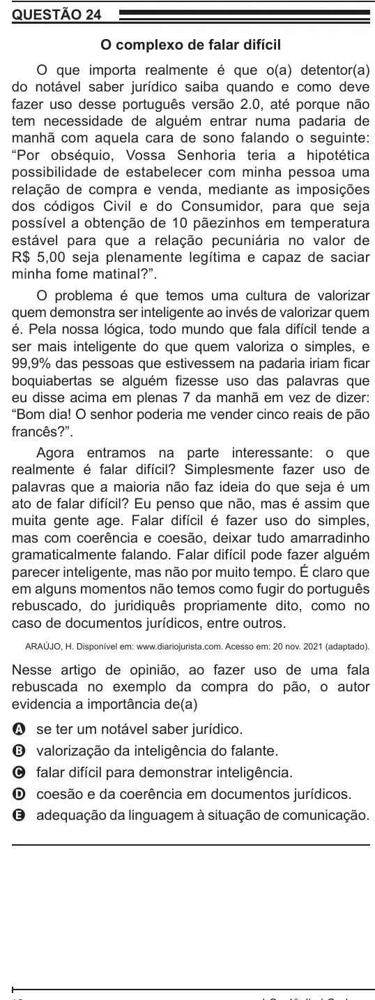

Texto extraído (pode conter ruído)

QUESTÃO 24  
O complexo de falar difícil  
O que importa realmente é que o(a) detentor(a)  
do notável saber jurídico saiba quando e como deve  
fazer uso desse português versão 2.0, até porque não  
tem necessidade de alguém entrar numa padaria de  
manhã com aquela cara de sono falando o seguinte:  
“Por obséquio, Vossa Senhoria teria a hipotética  
possibilidade de estabelecer com minha pessoa uma  
relação de compra e venda, mediante as imposições  
dos códigos Civil e do Consumidor, para que seja  
possível a obtenção de 10 pãezinhos em temperatura  
estável para que a relação pecuniária no valor de  
R$ 5,00 seja plenamente legítima e capaz de saciar  
minha fome matinal?”.  
O problema é que temos uma cultura de valorizar  
quem demonstra ser inteligente ao invés de valorizar quem  
é. Pela nossa lógica, todo mundo que fala difícil tende a  
ser mais inteligente do que quem valoriza o simples, e  
99,9% das pessoas que estivessem na padaria iriam ficar  
boquiabertas se alguém fizesse uso das palavras que  
eu disse acima em plenas 7 da manhã em vez de dizer:  
“Bom dia! O senhor poderia me vender cinco reais de pão  
francês?”.  
Agora entramos na parte interessante: o que  
realmente é falar difícil? Simplesmente fazer uso de  
palavras que a maioria não faz ideia do que seja é um  
ato de falar difícil? Eu penso que não, mas é assim que  
muita gente age. Falar difícil é fazer uso do simples,  
mas com coerência e coesão, deixar tudo amarradinho  
gramaticalmente falando. Falar difícil pode fazer alguém  
parecer inteligente, mas não por muito tempo. É claro que  
em alguns momentos não temos como fugir do português  
rebuscado, do juridiquês propriamente dito, como no  
caso de documentos jurídicos, entre outros.  
ARAÚJO, H. Disponível em: www.diariojurista.com. Acesso em: 20 nov. 2021 (adaptado).  
Nesse artigo de opinião, ao fazer uso de uma fala  
rebuscada no exemplo da compra do pão, o autor  
evidencia a importância de(a)  
se ter um notável saber jurídico.  
A  
valorização da inteligência do falante.  
B  
falar difícil para demonstrar inteligência.  
C  
coesão e da coerência em documentos jurídicos.  
D  
adequação da linguagem à situação de comunicação.  
E

