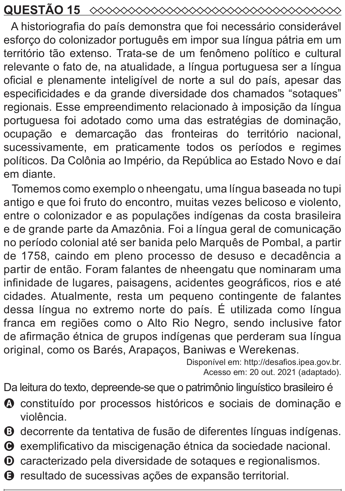

Texto extraído (pode conter ruído)

QUESTÃO 15  
A historiografia do país demonstra que foi necessário considerável  
esforço do colonizador português em impor sua língua pátria em um  
território tão extenso. Trata-se de um fenômeno político e cultural  
relevante o fato de, na atualidade, a língua portuguesa ser a língua  
oficial e plenamente inteligível de norte a sul do país, apesar das  
especificidades e da grande diversidade dos chamados “sotaques”  
regionais. Esse empreendimento relacionado à imposição da língua  
portuguesa foi adotado como uma das estratégias de dominação,  
ocupação e demarcação das fronteiras do território nacional,  
sucessivamente, em praticamente todos os períodos e regimes  
políticos. Da Colônia ao Império, da República ao Estado Novo e daí  
em diante.    
Tomemos como exemplo o nheengatu, uma língua baseada no tupi  
antigo e que foi fruto do encontro, muitas vezes belicoso e violento,  
entre o colonizador e as populações indígenas da costa brasileira  
e de grande parte da Amazônia. Foi a língua geral de comunicação  
no período colonial até ser banida pelo Marquês de Pombal, a partir  
de 1758, caindo em pleno processo de desuso e decadência a  
partir de então. Foram falantes de nheengatu que nominaram uma  
infinidade de lugares, paisagens, acidentes geográficos, rios e até  
cidades. Atualmente, resta um pequeno contingente de falantes  
dessa língua no extremo norte do país. É utilizada como língua  
franca em regiões como o Alto Rio Negro, sendo inclusive fator  
de afirmação étnica de grupos indígenas que perderam sua língua  
original, como os Barés, Arapaços, Baniwas e Werekenas.  
Disponível em: http://desafios.ipea.gov.br.  
Acesso em: 20 out. 2021 (adaptado).  
Da leitura do texto, depreende-se que o patrimônio linguístico brasileiro é  
A constituído por processos históricos e sociais de dominação e  
violência.  
B decorrente da tentativa de fusão de diferentes línguas indígenas.  
C exemplificativo da miscigenação étnica da sociedade nacional.  
D caracterizado pela diversidade de sotaques e regionalismos.  
E resultado de sucessivas ações de expansão territorial.

