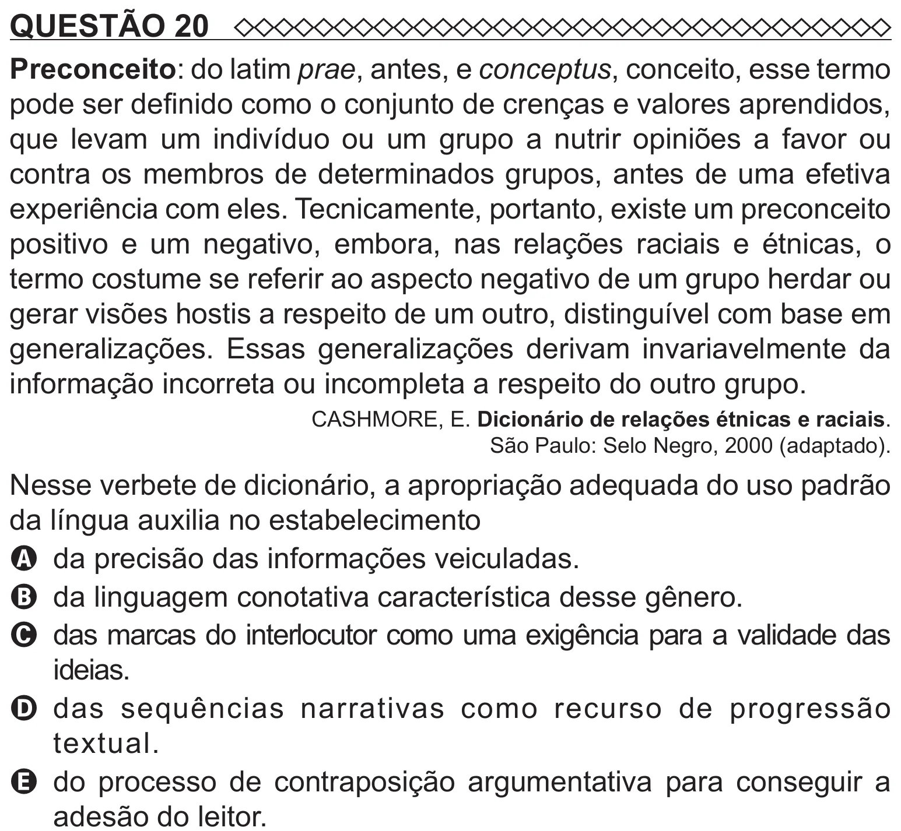

Texto extraído (pode conter ruído)

QUESTÃO 20  
Preconceito: do latim prae, antes, e conceptus, conceito, esse termo  
pode ser definido como o conjunto de crenças e valores aprendidos,  
que levam um indivíduo ou um grupo a nutrir opiniões a favor ou  
contra os membros de determinados grupos, antes de uma efetiva  
experiência com eles. Tecnicamente, portanto, existe um preconceito  
positivo e um negativo, embora, nas relações raciais e étnicas, o  
termo costume se referir ao aspecto negativo de um grupo herdar ou  
gerar visões hostis a respeito de um outro, distinguível com base em  
generalizações. Essas generalizações derivam invariavelmente da  
informação incorreta ou incompleta a respeito do outro grupo.  
CASHMORE, E. Dicionário de relações étnicas e raciais.  
São Paulo: Selo Negro, 2000 (adaptado).  
Nesse verbete de dicionário, a apropriação adequada do uso padrão  
da língua auxilia no estabelecimento  
A da precisão das informações veiculadas.  
B da linguagem conotativa característica desse gênero.  
C das marcas do interlocutor como uma exigência para a validade das  
ideias.  
D d as sequências narrativas como recurso de progressão  
textual.  
E do processo de contraposição argumentativa para conseguir a  
adesão do leitor.

