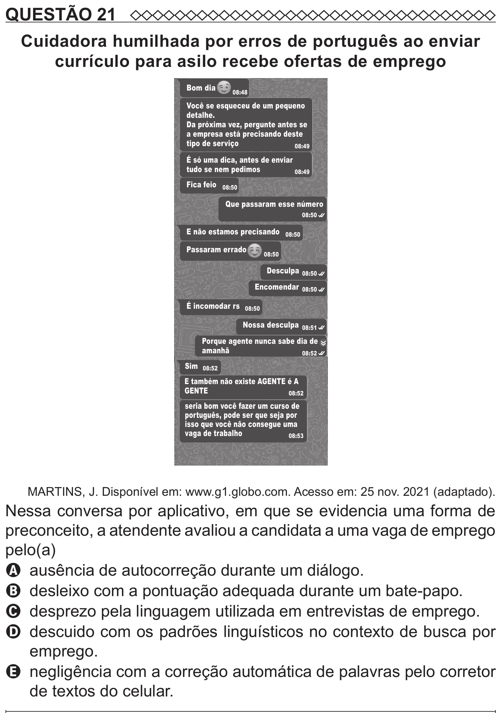

Texto extraído (pode conter ruído)

QUESTÃO 21  
Cuidadora humilhada por erros de português ao enviar  
currículo para asilo recebe ofertas de emprego  
Bom dia  
08:48  
Você se esqueceu de um pequeno  
detalhe.  
Da próxima vez, pergunte antes se  
a empresa está precisando deste  
tipo de serviço  
08:49  
É só uma dica, antes de enviar  
tudo se nem pedimos  
08:49  
Fica feio  
08:50  
Que passaram esse número  
08:50  
E não estamos precisando  
08:50  
Passaram errado  
08:50  
Desculpa 08:50  
Encomendar 08:50  
É incomodar rs 08:50  
Nossa desculpa 08:51  
Porque agente nunca sabe dia de  
amanhã  
08:52  
Sim 08:52  
E também não existe AGENTE é A  
GENTE  
08:52  
seria bom você fazer um curso de  
português, pode ser que seja por  
isso que você não consegue uma  
vaga de trabalho  
08:53  
MARTINS, J. Disponível em: www.g1.globo.com. Acesso em: 25 nov. 2021 (adaptado).  
Nessa conversa por aplicativo, em que se evidencia uma forma de  
preconceito, a atendente avaliou a candidata a uma vaga de emprego  
pelo(a)  
A ausência de autocorreção durante um diálogo.  
B desleixo com a pontuação adequada durante um bate-papo.  
C desprezo pela linguagem utilizada em entrevistas de emprego.  
D descuido com os padrões linguísticos no contexto de busca por  
emprego.  
E negligência com a correção automática de palavras pelo corretor  
de textos do celular.

