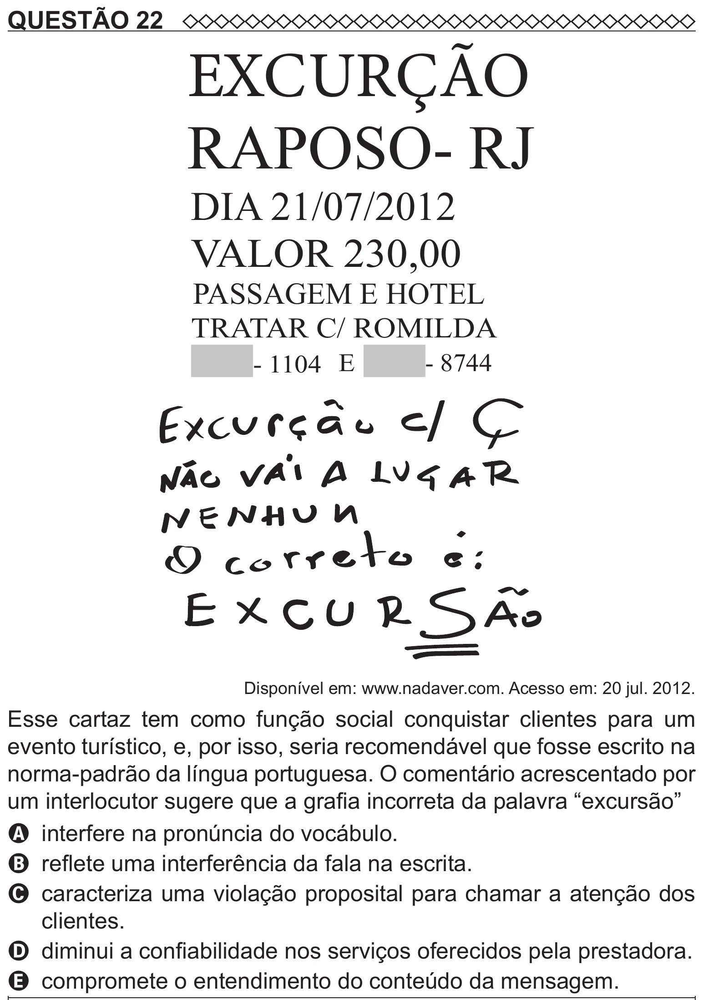

Texto extraído (pode conter ruído)

QUESTÃO 22  
  
RAPOSO- RJ  
DIA 21/07/2012  
VALOR 230,00  
PASSAGEM E HOTEL  
TRATAR C/ ROMILDA  
- 1104 E  
- 8744  
Disponível em: www.nadaver.com. Acesso em: 20 jul. 2012.  
Esse cartaz tem como função social conquistar clientes para um  
evento turístico, e, por isso, seria recomendável que fosse escrito na  
norma-padrão da língua portuguesa. O comentário acrescentado por  
um interlocutor sugere que a grafia incorreta da palavra “excursão”  
A interfere na pronúncia do vocábulo.  
B reflete uma interferência da fala na escrita.  
C caracteriza uma violação proposital para chamar a atenção dos  
clientes.  
D diminui a confiabilidade nos serviços oferecidos pela prestadora.  
E compromete o entendimento do conteúdo da mensagem.

