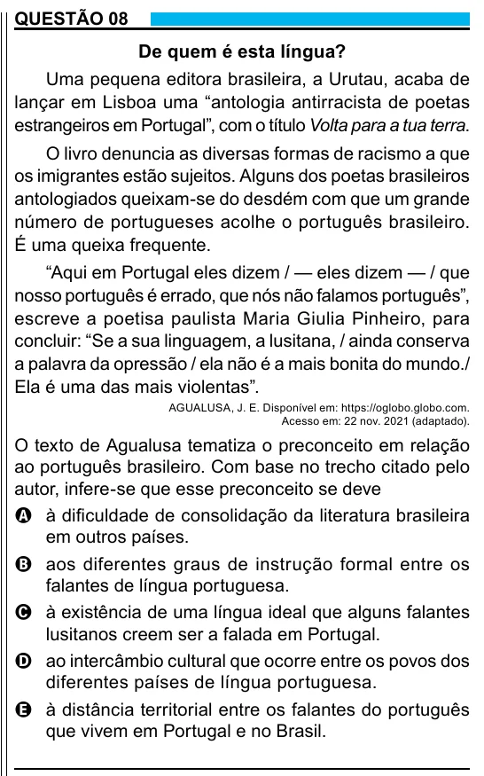

Texto extraído (pode conter ruído)

QUESTÃO 08  
De quem é esta língua?  
Uma pequena editora brasileira, a Urutau, acaba de  
lançar em Lisboa uma “antologia antirracista de poetas  
estrangeiros em Portugal”, com o título Volta para a tua terra.  
O livro denuncia as diversas formas de racismo a que  
os imigrantes estão sujeitos. Alguns dos poetas brasileiros  
antologiados queixam-se do desdém com que um grande  
número de portugueses acolhe o português brasileiro.  
É uma queixa frequente.  
“Aqui em Portugal eles dizem / — eles dizem — / que  
nosso português é errado, que nós não falamos português”,  
escreve a poetisa paulista Maria Giulia Pinheiro, para  
concluir: “Se a sua linguagem, a lusitana, / ainda conserva  
a palavra da opressão / ela não é a mais bonita do mundo./  
Ela é uma das mais violentas”.  
AGUALUSA, J. E. Disponível em: https://oglobo.globo.com.  
Acesso em: 22 nov. 2021 (adaptado).  
O texto de Agualusa tematiza o preconceito em relação  
ao português brasileiro. Com base no trecho citado pelo  
autor, infere-se que esse preconceito se deve  
A à dificuldade de consolidação da literatura brasileira  
em outros países.  
B aos diferentes graus de instrução formal entre os  
falantes de língua portuguesa.  
C à existência de uma língua ideal que alguns falantes  
lusitanos creem ser a falada em Portugal.  
D ao intercâmbio cultural que ocorre entre os povos dos  
diferentes países de língua portuguesa.  
E à distância territorial entre os falantes do português  
que vivem em Portugal e no Brasil.

