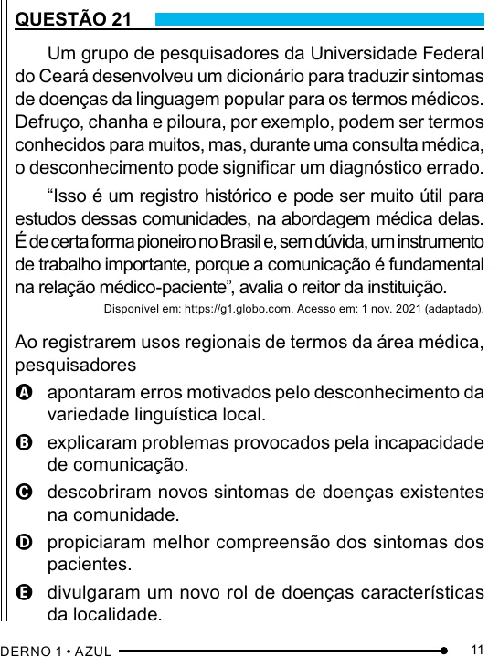

Texto extraído (pode conter ruído)

QUESTÃO 21  
Um grupo de pesquisadores da Universidade Federal  
do Ceará desenvolveu um dicionário para traduzir sintomas  
de doenças da linguagem popular para os termos médicos.  
Defruço, chanha e piloura, por exemplo, podem ser termos  
conhecidos para muitos, mas, durante uma consulta médica,  
o desconhecimento pode significar um diagnóstico errado.  
“Isso é um registro histórico e pode ser muito útil para  
estudos dessas comunidades, na abordagem médica delas.  
É de certa forma pioneiro no Brasil e, sem dúvida, um instrumento  
de trabalho importante, porque a comunicação é fundamental  
na relação médico-paciente”, avalia o reitor da instituição.  
Disponível em: https://g1.globo.com. Acesso em: 1 nov. 2021 (adaptado).  
Ao registrarem usos regionais de termos da área médica,  
pesquisadores  
A apontaram erros motivados pelo desconhecimento da  
variedade linguística local.  
B explicaram problemas provocados pela incapacidade  
de comunicação.  
C descobriram novos sintomas de doenças existentes  
na comunidade.  
D propiciaram melhor compreensão dos sintomas dos  
pacientes.  
E divulgaram um novo rol de doenças características  
da localidade.  
11

