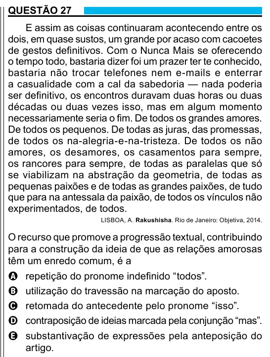

Texto extraído (pode conter ruído)

QUESTÃO 27  
E assim as coisas continuaram acontecendo entre os  
dois, em quase sustos, um grande por acaso com cacoetes  
de gestos definitivos. Com o Nunca Mais se oferecendo  
o tempo todo, bastaria dizer foi um prazer ter te conhecido,  
bastaria não trocar telefones nem e-mails e enterrar  
a casualidade com a cal da sabedoria — nada poderia  
ser definitivo, os encontros duravam duas horas ou duas  
décadas ou duas vezes isso, mas em algum momento  
necessariamente seria o fim. De todos os grandes amores.  
De todos os pequenos. De todas as juras, das promessas,  
de todos os na-alegria-e-na-tristeza. De todos os não  
amores, os desamores, os casamentos para sempre,  
os rancores para sempre, de todas as paralelas que só  
se viabilizam na abstração da geometria, de todas as  
pequenas paixões e de todas as grandes paixões, de tudo  
que para na antessala da paixão, de todos os vínculos não  
experimentados, de todos.  
LISBOA, A. Rakushisha. Rio de Janeiro: Objetiva, 2014.  
O recurso que promove a progressão textual, contribuindo  
para a construção da ideia de que as relações amorosas  
têm um enredo comum, é a  
A repetição do pronome indefinido “todos”.  
B utilização do travessão na marcação do aposto.  
C retomada do antecedente pelo pronome “isso”.  
D contraposição de ideias marcada pela conjunção “mas”.  
E substantivação de expressões pela anteposição do  
artigo.

