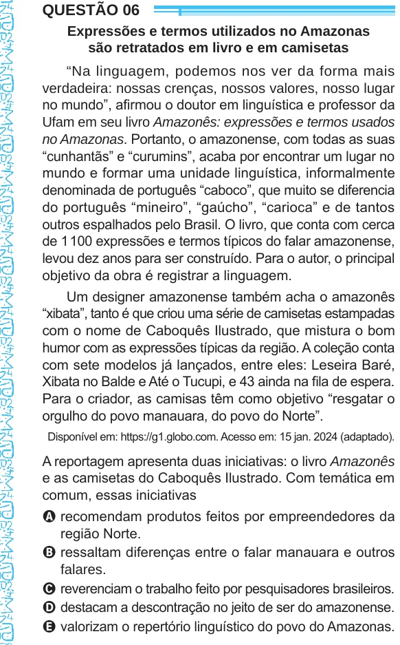

Texto extraído (pode conter ruído)

QUESTÃO 06  
Expressões e termos utilizados no Amazonas  
são retratados em livro e em camisetas  
“Na linguagem, podemos nos ver da forma mais  
verdadeira: nossas crenças, nossos valores, nosso lugar  
no mundo”, afirmou o doutor em linguística e professor da  
Ufam em seu livro Amazonês: expressões e termos usados  
no Amazonas. Portanto, o amazonense, com todas as suas  
“cunhantãs” e “curumins”, acaba por encontrar um lugar no  
mundo e formar uma unidade linguística, informalmente  
denominada de português “caboco”, que muito se diferencia  
do português “mineiro”, “gaúcho”, “carioca” e de tantos  
outros espalhados pelo Brasil. O livro, que conta com cerca  
de 1 100 expressões e termos típicos do falar amazonense,  
levou dez anos para ser construído. Para o autor, o principal  
objetivo da obra é registrar a linguagem.  
Um designer amazonense também acha o amazonês  
“xibata”, tanto é que criou uma série de camisetas estampadas  
com o nome de Caboquês Ilustrado, que mistura o bom  
humor com as expressões típicas da região. A coleção conta  
com sete modelos já lançados, entre eles: Leseira Baré,  
Xibata no Balde e Até o Tucupi, e 43 ainda na fila de espera.  
Para o criador, as camisas têm como objetivo “resgatar o  
orgulho do povo manauara, do povo do Norte”.  
Disponível em: https://g1.globo.com. Acesso em: 15 jan. 2024 (adaptado).  
A reportagem apresenta duas iniciativas: o livro Amazonês  
e as camisetas do Caboquês Ilustrado. Com temática em  
comum, essas iniciativas  
A recomendam produtos feitos por empreendedores da  
região Norte.  
B ressaltam diferenças entre o falar manauara e outros  
falares.  
C reverenciam o trabalho feito por pesquisadores brasileiros.  
D destacam a descontração no jeito de ser do amazonense.  
E valorizam o repertório linguístico do povo do Amazonas.

