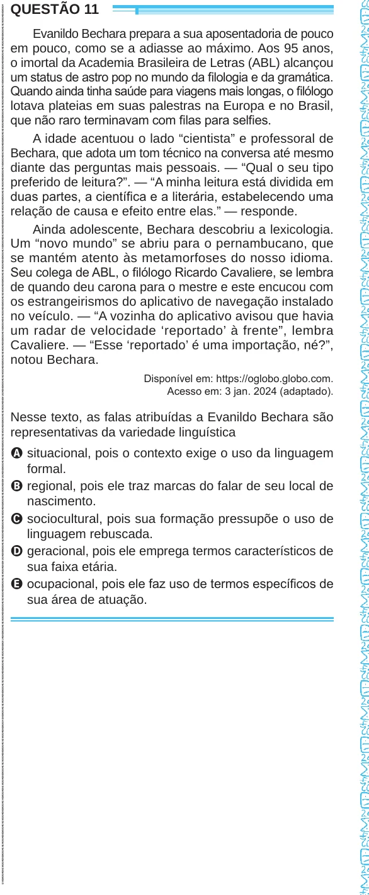

Texto extraído (pode conter ruído)

ENEM2024ENEM2024ENEM2024ENEM2024ENEM2024ENEM2024ENEM2024ENEM2024ENEM2024ENEM2024ENEM2024ENEM2024ENEM2024ENEM2024ENEM2024ENEM2024ENEM2024ENEM2024ENEM2024ENEM2024ENEM2024ENEM2024ENEM2024ENEM2024ENEM2024ENEM2024ENEM2024ENEM2024ENEM2024ENEM2024ENEM2024ENEM2024ENEM2024ENEM2024ENEM2024ENEM2024ENEM2024ENEM2024ENEM2024ENEM2024ENEM2024ENEM2024ENEM2024ENEM2024ENEM2024ENEM2024ENEM2024ENEM2024ENEM2024ENEM2024ENEM2024ENEM2024ENEM2024ENEM2024ENEM2024ENEM2024ENEM2024ENEM2024ENEM2024ENEM2024ENEM2024ENEM2024ENEM2024ENEM2024ENEM2024ENEM2024ENEM2024ENEM2024ENEM2024ENEM2024ENEM2024ENEM2024ENEM2024ENEM2024ENEM2024  
QUESTÃO 11  
Evanildo Bechara prepara a sua aposentadoria de pouco  
em pouco, como se a adiasse ao máximo. Aos 95 anos,  
o imortal da Academia Brasileira de Letras (ABL) alcançou  
um status de astro pop no mundo da filologia e da gramática.  
Quando ainda tinha saúde para viagens mais longas, o filólogo  
lotava plateias em suas palestras na Europa e no Brasil,  
que não raro terminavam com filas para selfies.  
A idade acentuou o lado “cientista” e professoral de  
Bechara, que adota um tom técnico na conversa até mesmo  
diante das perguntas mais pessoais. — “Qual o seu tipo  
preferido de leitura?”. — “A minha leitura está dividida em  
duas partes, a científica e a literária, estabelecendo uma  
relação de causa e efeito entre elas.” — responde.  
Ainda adolescente, Bechara descobriu a lexicologia.  
Um “novo mundo” se abriu para o pernambucano, que  
se mantém atento às metamorfoses do nosso idioma.  
Seu colega de ABL, o filólogo Ricardo Cavaliere, se lembra  
de quando deu carona para o mestre e este encucou com  
os estrangeirismos do aplicativo de navegação instalado  
no veículo. — “A vozinha do aplicativo avisou que havia  
um radar de velocidade ‘reportado’ à frente”, lembra  
Cavaliere. — “Esse ‘reportado’ é uma importação, né?”,  
notou Bechara.  
Disponível em: https://oglobo.globo.com.  
Acesso em: 3 jan. 2024 (adaptado).  
Nesse texto, as falas atribuídas a Evanildo Bechara são  
representativas da variedade linguística  
A situacional, pois o contexto exige o uso da linguagem  
formal.  
B regional, pois ele traz marcas do falar de seu local de  
nascimento.  
C sociocultural, pois sua formação pressupõe o uso de  
linguagem rebuscada.  
D geracional, pois ele emprega termos característicos de  
sua faixa etária.  
E ocupacional, pois ele faz uso de termos específicos de  
sua área de atuação.

