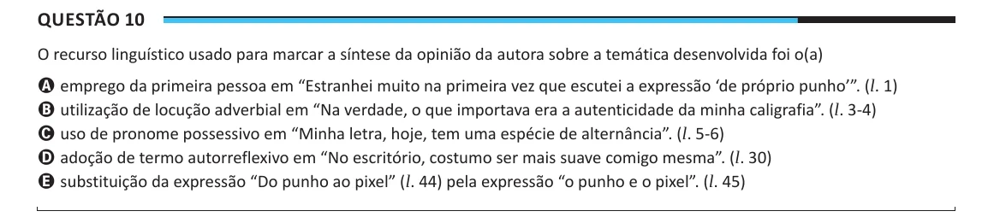

Texto extraído (pode conter ruído)

Questão 10  
O recurso linguístico usado para marcar a síntese da opinião da autora sobre a temática desenvolvida foi o(a)  
A emprego da primeira pessoa em “Estranhei muito na primeira vez que escutei a expressão ‘de próprio punho’”. (l. 1)  
B utilização de locução adverbial em “Na verdade, o que importava era a autenticidade da minha caligrafia”. (l. 3-4)  
C uso de pronome possessivo em “Minha letra, hoje, tem uma espécie de alternância”. (l. 5-6)  
D adoção de termo autorreflexivo em “No escritório, costumo ser mais suave comigo mesma”. (l. 30)  
E substituição da expressão “Do punho ao pixel” (l. 44) pela expressão “o punho e o pixel”. (l. 45)

