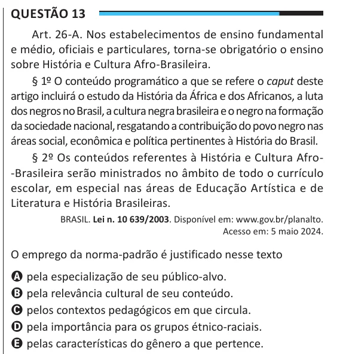

Texto extraído (pode conter ruído)

Questão 13  
Art. 26-A. Nos estabelecimentos de ensino fundamental  
e médio, oficiais e particulares, torna-se obrigatório o ensino  
sobre História e Cultura Afro-Brasileira.  
§ 1º O conteúdo programático a que se refere o caput deste  
artigo incluirá o estudo da História da África e dos Africanos, a luta  
dos negros no Brasil, a cultura negra brasileira e o negro na formação  
da sociedade nacional, resgatando a contribuição do povo negro nas  
áreas social, econômica e política pertinentes à História do Brasil.  
§ 2º Os conteúdos referentes à História e Cultura Afro-  
-Brasileira serão ministrados no âmbito de todo o currículo  
escolar, em especial nas áreas de Educação Artística e de  
Literatura e História Brasileiras.  
BRASIL. Lei n. 10 639/2003. Disponível em: www.gov.br/planalto.  
Acesso em: 5 maio 2024.  
O emprego da norma-padrão é justificado nesse texto  
A pela especialização de seu público-alvo.  
B pela relevância cultural de seu conteúdo.  
C pelos contextos pedagógicos em que circula.  
D pela importância para os grupos étnico-raciais.  
E pelas características do gênero a que pertence.

