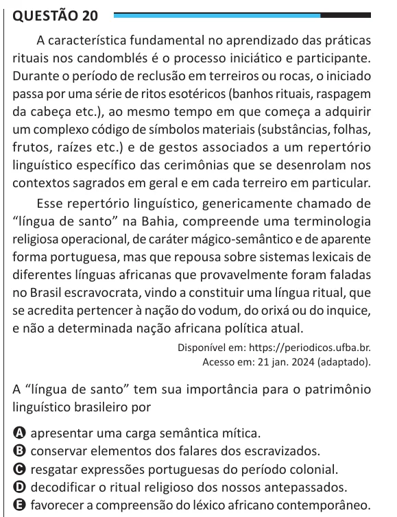

Texto extraído (pode conter ruído)

Questão 20  
A característica fundamental no aprendizado das práticas  
rituais nos candomblés é o processo iniciático e participante.  
Durante o período de reclusão em terreiros ou rocas, o iniciado  
passa por uma série de ritos esotéricos (banhos rituais, raspagem  
da cabeça etc.), ao mesmo tempo em que começa a adquirir  
um complexo código de símbolos materiais (substâncias, folhas,  
frutos, raízes etc.) e de gestos associados a um repertório  
linguístico específico das cerimônias que se desenrolam nos  
contextos sagrados em geral e em cada terreiro em particular.  
Esse repertório linguístico, genericamente chamado de  
“língua de santo” na Bahia, compreende uma terminologia  
religiosa operacional, de caráter mágico-semântico e de aparente  
forma portuguesa, mas que repousa sobre sistemas lexicais de  
diferentes línguas africanas que provavelmente foram faladas  
no Brasil escravocrata, vindo a constituir uma língua ritual, que  
se acredita pertencer à nação do vodum, do orixá ou do inquice,  
e não a determinada nação africana política atual.  
Disponível em: https://periodicos.ufba.br.  
Acesso em: 21 jan. 2024 (adaptado).  
A “língua de santo” tem sua importância para o patrimônio  
linguístico brasileiro por  
A apresentar uma carga semântica mítica.  
B conservar elementos dos falares dos escravizados.  
C resgatar expressões portuguesas do período colonial.  
D decodificar o ritual religioso dos nossos antepassados.  
E favorecer a compreensão do léxico africano contemporâneo.

