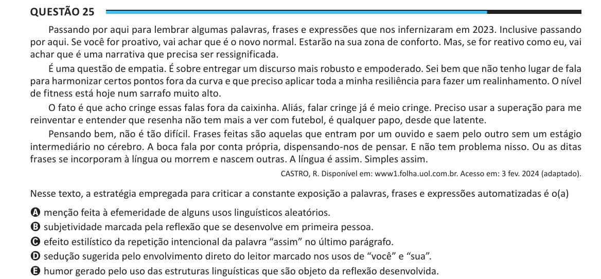

Texto extraído (pode conter ruído)

Questão 25  
Passando por aqui para lembrar algumas palavras, frases e expressões que nos infernizaram em 2023. Inclusive passando  
por aqui. Se você for proativo, vai achar que é o novo normal. Estarão na sua zona de conforto. Mas, se for reativo como eu, vai  
achar que é uma narrativa que precisa ser ressignificada.  
É uma questão de empatia. É sobre entregar um discurso mais robusto e empoderado. Sei bem que não tenho lugar de fala  
para harmonizar certos pontos fora da curva e que preciso aplicar toda a minha resiliência para fazer um realinhamento. O nível  
de fitness está hoje num sarrafo muito alto.  
O fato é que acho cringe essas falas fora da caixinha. Aliás, falar cringe já é meio cringe. Preciso usar a superação para me  
reinventar e entender que resenha não tem mais a ver com futebol, é qualquer papo, desde que latente.  
Pensando bem, não é tão difícil. Frases feitas são aquelas que entram por um ouvido e saem pelo outro sem um estágio  
intermediário no cérebro. A boca fala por conta própria, dispensando-nos de pensar. E não tem problema nisso. Ou as ditas  
frases se incorporam à língua ou morrem e nascem outras. A língua é assim. Simples assim.  
CASTRO, R. Disponível em: www1.folha.uol.com.br. Acesso em: 3 fev. 2024 (adaptado).  
Nesse texto, a estratégia empregada para criticar a constante exposição a palavras, frases e expressões automatizadas é o(a)  
A menção feita à efemeridade de alguns usos linguísticos aleatórios.  
B subjetividade marcada pela reflexão que se desenvolve em primeira pessoa.  
C efeito estilístico da repetição intencional da palavra “assim” no último parágrafo.  
D sedução sugerida pelo envolvimento direto do leitor marcado nos usos de “você” e “sua”.  
E humor gerado pelo uso das estruturas linguísticas que são objeto da reflexão desenvolvida.

