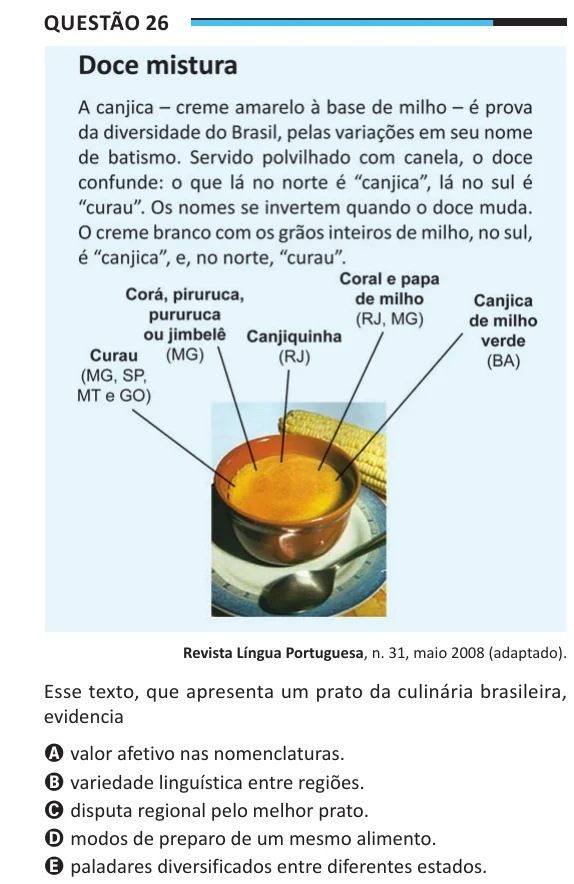

Texto extraído (pode conter ruído)

Questão 26  
Revista Língua Portuguesa, n. 31, maio 2008 (adaptado).  
Esse texto, que apresenta um prato da culinária brasileira,  
evidencia  
A valor afetivo nas nomenclaturas.  
B variedade linguística entre regiões.  
C disputa regional pelo melhor prato.  
D modos de preparo de um mesmo alimento.  
E paladares diversificados entre diferentes estados.

